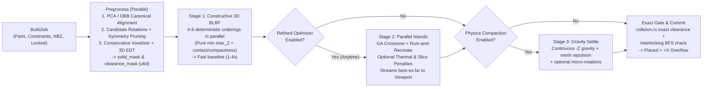

# NestCraft 3D Nesting & Gravity Compaction — Detailed Architecture & Implementation Plan

> **Scope:** Pure-Rust 3D true-shape powder-bed SLS nesting (`crates/nestcraft-core`) and interactive UI (`apps/nestcraft`), built to complement the existing 2D bitmap nester ([`nest2d.rs`](../crates/nestcraft-core/src/nest2d.rs)), exact clearance verifier ([`collision.rs`](../crates/nestcraft-core/src/collision.rs)), slice analyzer ([`slice.rs`](../crates/nestcraft-core/src/slice.rs)), and thermal map ([`thermal.rs`](../crates/nestcraft-core/src/thermal.rs)).
>
> **Implementation Status (`sls-dev` @ `b79c6dc01`+):** **Phases 1, 2, 3, 4, and 5 are `Done`** ([`voxel.rs`](../crates/nestcraft-core/src/voxel.rs), [`interlock.rs`](../crates/nestcraft-core/src/interlock.rs), [`nest3d.rs`](../crates/nestcraft-core/src/nest3d.rs) Stage 1 live-streaming BLBF + Stage 2 parallel island GA / Ruin-and-Recreate with thermal/slice objectives + exact final gate, [`compact.rs`](../crates/nestcraft-core/src/compact.rs) `rapier3d`/`parry3d` V-HACD gravity settle, and `apps/nestcraft` two-tier modals + non-blocking bottom progress bar). **Phase 6 (`Planned`)** covers 30–150 part Netfabb benchmarks and `--mcp` automation hooks.
>
> **Related Docs:** [`sls-feature-matrix.md`](sls-feature-matrix.md) · [`sls-nesting-plan.md`](sls-nesting-plan.md) · [`sls-nesting-migration.md`](sls-nesting-migration.md)

---

## 1. Locked-In Design Decisions

| Topic | Decision | Rationale |
| :--- | :--- | :--- |
| **Target Workload** | **30–150 parts** per build (EOS Formiga P110 `200×250×330 mm`, Farsoon HT403P/SS403P `400×400×450 mm`, Custom) | Fast enough for an interactive baseline in **1–4 s**, with anytime global refinement over **10–60 s** and live **Stop & Apply** |
| **Configurability** | **All options selectable** in the UI + quick presets (`Fast`, `Balanced`, `Refined`, `Custom`) | Operators can choose constructive-only vs. GA / Ruin-and-Recreate, physics compaction, rotation sets, resolution, and thermal/slice weights |
| **Cavities & Interlocking** | **Open cavities allowed** (Netfabb parity); **topological interlocking prevented** by default (selectable) | Maximizes packing density inside brackets/housings while guaranteeing every part can be separated during depowdering |
| **Thermal & Slice Balance** | Applied **only in refined methods** (Stage 2 GA / Ruin-and-Recreate), optional & weight-tunable | Keeps Stage 1 constructive placement pure `min(max_Z)` + compactness for maximum speed; avoids PA12 curl / "egg effect" in refined builds |
| **Resolution & Adaptive Clearance** | Continuous **`Fast (2.0 mm) ↔ Fine (0.5 mm)`** resolution slider; **Fixed** or **Separate XY/Z** min distance; optional **Part-Mass Adaptive (`r_A + r_B`)** across all stages + **Area/Density Spacing** in refined Stage 2 only | Balances speed vs. precision; adds extra spacing around bulky/thick heat-retaining parts at zero packing cost while spreading crowded thermal regions during refinement |
| **Physics / Gravity Compaction** | Available both as **Stage 3 polish** after 3D nesting **and** as a standalone **`Gravity Settle / Compact`** tool | Removes discrete voxel staircase slack (`~3–8%` extra height reduction) and lets operators compact manually arranged beds without reshuffling |
| **Z-Height Limit** | Optional **`Max Z Limit (mm)`** ceiling (`<= machine Z - wall_margin_mm`) | Enforces customer/schedule height caps; caps the voxel tray Z-depth for faster runs and routes excess parts to `+X` overflow |
| **Incremental / Scope Controls** | **`Pack Selected Only`** toggle + **`Keep Parts Inside Build Volume`** toggle | Lets operators pack only newly imported/selected parts or outside parts into remaining empty space without touching anything already placed inside the chamber |
| **Non-Intrusive Progress & Break** | **Bottom-docked progress bar** (no blocking modal) + cooperative **`Stop & Apply Best`** / **`Cancel`** (`Arc<AtomicBool>`) | Keeps 3D camera orbit/pan/zoom interactive while refining and stops cleanly within milliseconds on user break |
| **Resource Guardrails (RAM & CPU)** | Pre-flight RAM estimator + `sysinfo` modal warning (**Auto-Fit Resolution**) + hard `try_reserve` cap; default **75% CPU threads** via workspace `rayon` pool (leaving `>= 2` cores free) | Prevents OOM crashes on huge custom chambers / `0.5 mm` grids and keeps the desktop + 60 FPS viewport responsive instead of pegging 100% CPU |
| **Safety & Determinism** | Pure Rust in `nestcraft-core` (`unsafe_code = "forbid"`, no `unwrap`/`expect`/`panic`), exact final clearance via [`collision.rs`](../crates/nestcraft-core/src/collision.rs) | Hostile STLs never crash; guaranteed `>= clearance_mm` and `NoBuildZone` safety before committing results |

---

## 2. Method Comparison & Why a Hybrid Pipeline Wins

No single algorithm solves 3D SLS nesting well on its own:

| Method | Strengths | Weaknesses | Role in NestCraft |
| :--- | :--- | :--- | :--- |
| **Voxel Bitgrid + 3D EDT + Constructive BLBF** | `O(1)` bitwise `&` collision probing (`u64` words), handles arbitrary concave shapes & cavities, trivially stamps `locked` parts & `NoBuildZone` | Discrete voxel slack (`0.5–1.5 mm`), greedy placement quality depends strongly on part order & orientation | **Stage 1 Inner Decoder** (fast baseline & inner engine for Stage 2) |
| **Ruin-and-Recreate (ALNS) / Simulated Annealing** | Rips out only the top-Z band or a hotspot cluster (~15–25% of parts) and re-packs into the remaining tray — **4×–8× faster per iteration** than full-bed re-packing | Can miss global ordering shifts across bottom-layer parts if used alone | **Stage 2 Primary Anytime Optimizer** |
| **Genetic Algorithm (GA) / Island Evolution** | Parallelizes cleanly across CPU cores, mixes good sub-sequences & orientation genes via crossover, naturally supports multi-objective fitness | Needs a sub-100 ms inner decoder to complete meaningful generations in a 15–60 s budget | **Stage 2 Global Search** (paired with Ruin-and-Recreate in parallel worker islands) |
| **Physics / Gravity Drop & Repulsion** | Continuous sub-mm coordinates (zero voxel slack), supports smooth `±5°–15°` micro-rotations to settle into angled gaps | **Jams and bridges** if used alone (flat parts act as umbrellas blocking space underneath; cannot swap large/small parts) | **Stage 3 Continuous Compaction** + standalone **`Gravity Settle`** tool |
| **Exact Mesh / 3D NFP / BVH** | Zero discretization error | True 3D NFP for non-convex meshes is too slow and fragile on real customer STLs | **Final Exact Gate** via existing [`collision.rs`](../crates/nestcraft-core/src/collision.rs) & local `MeshBvh` |

### External Crates Policy (License & Fit Survey)
- **Adopt (`rapier3d` `0.33` + `parry3d` `0.31`, Apache-2.0, pure Rust, WASM-ready):** Used in Phase 5 (`Gravity Settle`) for rigid-body gravity, contact manifolds, sleeping detection, **`parry3d::transformation::vhacd`** approximate convex decomposition, and `Qbvh` queries — avoiding hand-rolled torque/rigid-body physics.
- **Reuse Workspace Crates (`rayon` `1.12` + `sysinfo` `0.40.1`, MIT/Apache-2.0):** `nestcraft-core` uses budgeted `rayon::ThreadPoolBuilder` pools for parallel voxelization/BLBF/islands, and `apps/nestcraft` uses `sysinfo` for live RAM pre-flight warnings.
- **Skipped Alternatives:**
  - *3D Box Packers (`u-nesting-d3`, `bin-packing`, `binpack-3d`, `bin_packer_3d`):* Pack orthogonal cuboids only in 3D; cannot nest irregular concave 3D meshes inside open cavities with SLS interlocking & thermal rules.
  - *Raycast SDF (`mesh_to_sdf`):* Raycast inside/outside sign classification is fragile on non-manifold STLs and uses dense `f32` grids (`32×` more RAM than our `u64` bitpacked anisotropic [`voxel.rs`](../crates/nestcraft-core/src/voxel.rs)).
  - *Stateless GA Crates (`genetic_algorithm`, `metaheuristics-nature`):* Require full-bed chromosome re-evaluation, whereas our Ruin-and-Recreate islands mutate a live `BitGrid3D` tray in-place (`4–8×` faster) with `<50 ms` `AtomicBool` cancellation.

---

## 3. Hybrid 3-Stage Architecture

---

## 4. Detailed Subsystem Design

### 4.1 Voxelization, 3D EDT & Orientation Catalog (`crates/nestcraft-core/src/voxel.rs`)

1. **Resolution, Tray Bitgrid & Memory Lifecycle (`Fast 2.0 mm ↔ Balanced 1.0 mm ↔ Fine 0.5 mm`):**
   - Continuous `resolution_mm` slider from **`2.0 mm` (Fast)** to **`0.5 mm` (Fine)** with quick preset snaps (`Fast = 2.0 mm`, `Balanced = 1.0 mm`, `Fine = 0.5 mm`):
     - `2.0 mm` (Fast): `200×200×225` HT403P tray (`~1.1 MB`), `100×125×165` P110 tray (`~0.25 MB`) — fastest search, with Stage 3 physics compaction reclaiming discrete voxel slack.
     - `1.0 mm` (Balanced): `400×400×450` HT403P tray (`~9.0 MB`), `200×250×330` P110 tray (`~2.0 MB`) — daily default for 30–150 mixed parts.
     - `0.5 mm` (Fine): `800×800×900` HT403P tray (`~72 MB`), `400×500×660` P110 tray (`~16 MB`) — tiny features & tight open cavities; auto-clamped to a safe search-tray memory budget (`<= ~128M` voxels ≈ `16 MB`) on very large custom chambers while keeping Stage 3 continuous compaction at full exact precision.
   - Build tray stored as a compact `u64`-bitpacked 3D bitgrid along the fastest-scanning axis (`X` or `Y`), plus an incrementally updated **2D XY heightmap** (`max_z` / `first_free_z` per `(x, y)` column) to skip empty air and saturated floor cells in `O(1)`.
   - Static obstacles — visible `locked` instances, visible unselected instances (when `selected_only == true`), visible instances already inside the raw machine envelope (when `keep_in_bounds_fixed == true`), and enabled `NoBuildZone` dilated by `zone.clearance_mm` — are pre-stamped into a reusable `base_tray` snapshot once at startup and are never moved or rotated. **Hidden parts are ignored completely** (neither moved nor stamped as invisible walls, matching [`nest2d.rs`](../crates/nestcraft-core/src/nest2d.rs) and [`collision.rs`](../crates/nestcraft-core/src/collision.rs)).
   - **Per-Prototype Caching & Staged Memory Release (keeps RAM low & CPU cache hot):**
     - Cache voxel masks, OBBs, and local-space BVHs strictly per unique **`PartId`** (never per `InstanceId`).
     - Reuse a single thread-local `f32` EDT scratch buffer per worker and drop it immediately after packing into `u64` masks (`32×` smaller).
     - Drop static obstacle masks (`locked` / `keep_in_bounds_fixed` / unselected / `NoBuildZone`) immediately after stamping `base_tray`.
     - In `Constructive Only` mode, release each `PartId`'s orientation masks as soon as all its instances are placed.
     - Drop **all** 3D voxel bitgrids, heightmaps, and masks before entering Stage 3 (`Gravity Settle`) so continuous compaction gets clean L2/L3 cache and RAM headroom.

2. **Conservative Non-Manifold-Safe Voxelization:**
   - Every unique `(PartPrototype, orientation)` is voxelized into a dense bitgrid using **conservative triangle-AABB surface rasterization + bounded exterior 3D flood-fill** from the padded bounding-box shell (`solid = !exterior_reachable`).
   - Unlike ray-parity fill, exterior flood-fill is exact on watertight meshes regardless of flipped triangle normals and **never produces infinite solid streaks** on leaky/non-manifold customer STLs.
   - **Open cavities remain open:** Any pocket reachable from the exterior shell stays `0` bits so smaller parts can nest inside them (unless the user enables **"Disable Cavity Nesting"** to fill pockets / convex hull).

3. **Felzenszwalb-Huttenlocher 3D Euclidean Distance Transform (3D EDT) & Adaptive Part Clearance:**
   - Computed in three 1D separable parabolic lower-envelope passes (`O(N)` in voxel count, pure Rust, zero external crates) on the padded `solid_mask` bounding box.
   - **Anisotropic XY / Z Clearance:** Optionally scales the Z-axis distance metric by `clearance_xy / clearance_z` inside the 1D Z-pass so vertical spacing can be larger than horizontal spacing (e.g. `2.5 mm XY` / `3.5 mm Z` for downskin over-cure) at zero extra runtime cost.
   - **Adaptive Part-Mass / Thickness Half-Clearance (optional):**
     - When enabled, each `PartPrototype` `P` is assigned a half-clearance `r_P ∈ [min_gap / 2, max_gap / 2]` scaled smoothly by its solid volume (or peak interior EDT wall thickness), e.g. `2.0 mm` between two small clips, `3.25 mm` between a clip and a massive block, and `4.5 mm` between two massive blocks (`pair_gap(A, B) = r_A + r_B`).
     - Because `r_P` is baked once into `P`'s `clearance_mask` during preprocessing, part-mass adaptive spacing runs at **zero runtime overhead** across Stage 1, Stage 2, and Stage 3.
   - Produces two `u64`-bitpacked masks per `(PartPrototype, orientation)`:
     - `solid_mask` (`EDT == 0`): exact part occupancy (used for thermal density, slice area, cavity checks, and interlocking escape simulation).
     - `clearance_mask` (`EDT <= r_P + 0.25 * pitch` to `0.5 * pitch`): tight dilated half-clearance shell. Using tight dilation (rather than full `0.5*sqrt(3)*pitch` double-padding) keeps narrow open cavities accessible and avoids wasting 1.5–3 mm of packing density, while Stage 3 exact repulsion and the final [`collision.rs`](../crates/nestcraft-core/src/collision.rs) gate catch any sub-voxel grazing pairs.

4. **Smart Rotation Handling & Coarse-First Symmetry Pruning:**
   - **Pre-alignment:** Before generating discrete angles, compute each prototype's **PCA / 3D OBB principal axes** so arbitrarily tilted CAD imports align cleanly with the machine axes (when `XY Rotation > 0°` and `PCA / OBB Pre-Alignment` is enabled).
   - **XY & Z Rotation Step Sliders (with `0° (Locked)`):**
     - `Orientation`: `Per-Part` (respects per-part `RotationConstraint`, capped by the XY/Z sliders) vs `Override All` (applies the XY/Z sliders to all movable parts).
     - `XY Rotation` slider: `0° (Locked)` / `180°` / `90°` (6 cardinal faces) / `45°` / `30°`. Setting `0°` replaces separate `Force Fixed` / `Force Z-Only` modes.
     - `Z Rotation` slider: `0° (Locked)` / `180°` / `90°` / `45°` / `30°` / `15°`. Setting both `XY = 0°` and `Z = 0°` keeps every part fixed; `XY = 0°` + `Z > 0°` performs Z-only nesting; `XY > 0°` + `Z = 0°` tilts XY while preserving instance Z yaw.
   - **Coarse-First Voxel Symmetry Pruning:** Hash candidate orientations at a fast **`3–4 mm` coarse pitch** (plus bounding dimensions) *before* running fine `0.5–1.0 mm` voxelization and 3D EDT, deduplicating identical masks up front. A symmetric cube collapses `24 -> 1`; a cylinder collapses `24 -> 3` — avoiding wasted fine EDTs on symmetric duplicates.
   - **Orientation Ordering:** Sort each part's surviving unique orientations by `(bounding_z, footprint_area)` ascending so low-profile orientations are probed first.

---

### 4.2 Open Cavities Allowed, Interlocking Prevented (`crates/nestcraft-core/src/interlock.rs`)

Netfabb allows nesting a smaller part **inside** an open pocket or under an arch (high packing density), **as long as** the part is not topologically trapped so operators can separate parts after depowdering.

1. **AABB Pre-Filter & Fast Constructive Sweep (during candidate placement):**
   - **AABB pre-filter:** Skip interlocking checks completely unless the candidate placement's world AABB overlaps at least one already-placed neighbor's world AABB (eliminates >80% of checks in `O(1)`).
   - When an AABB overlap exists (e.g., nesting inside an arch or pocket), run a fast **6-axis + 8-diagonal ray-sweep escape test** on `P`'s `solid_mask`:
     - Sweep `P`'s `solid_mask` along `+Z, -Z, +X, -X, +Y, -Y` (and optional 45° diagonals) until `P`'s AABB exits the combined occupied bounding box of surrounding parts.
     - A part resting on the floor or inside an open cup passes immediately because **at least one direction** (e.g. `+Z`) exits unobstructed; bitwise `u64` swept-mask shifting takes microseconds.

2. **Multi-Step Translational Escape Check & Sequential Peeling Invariant:**
   - If straight-line sweeps are blocked by a curved lip or overhang (a part that *can* slide sideways then lift out, vs. a true ring/ball-joint trap), run a bounded **voxel BFS translational un-nesting check** on `P`'s `solid_mask` against the local `tray_solid` (allowing `0` or `0.5 * clearance_mm` rigid translation steps in 6/18/26 directions up to an escape radius outside the blocker AABB).
   - If **no** collision-free rigid translation path exists, reject the candidate `(x, y, z, rot)` as **interlocked** (`prevent_interlocking == true`).
   - **Sequential Peeling Proof & Post-Compaction Check:** Because every newly placed part `P` is verified to escape from all previously placed parts `S` *without moving `S`*, reverse placement order is guaranteed to be a valid sequential depowdering/peeling sequence for Stage 1 and Stage 2. Because Stage 3 (`Gravity Settle`) moves parts simultaneously, run a full sequential peeling pass after Stage 3 when `prevent_interlocking` is enabled (rolling back any move that creates a trap).
   - Also expose a standalone **`Check Interlocking`** diagnostic (for `Analyze` banner / `F5` summary) that reports any trapped pairs on the current bed.

---

### 4.3 Stage 1: Constructive 3D Placement (`crates/nestcraft-core/src/nest3d.rs`)

- **Placement Policy (Z-first Bottom-Left-Back-Fill with Heightmap Skip):**
  - For each part and candidate orientation, scan `z` from `min_z` upward (clamped by optional `max_z_limit`), scanning `(x, y)` inside `tray_bounds`.
  - **Score each valid position** (evaluating top candidates in the lowest viable `z` band):
    $$\text{score} = w_z \cdot z_{\text{top}} + w_{z0} \cdot z_{\text{min}} - w_{\text{contact}} \cdot \text{neighbor\_contact} + w_{\text{xy}} \cdot (x + y)$$
    Rewarding adjacent neighbor/wall/floor contact keeps parts tight against existing clusters rather than scattering islands across the bed.
- **Multi-Order Parallel Portfolio:**
  - Run `6–8` deterministic orderings in parallel via workspace **`rayon`** (`ThreadPoolBuilder::new().num_threads(workers)` honoring `CpuBudget`, matching [`nest2d.rs`](../crates/nestcraft-core/src/nest2d.rs)):
    1. Volume descending
    2. Bounding-box volume descending
    3. Max dimension descending (long shafts/plates first)
    4. Height (`dz`) descending
    5. Surface area / compactness ratio descending
    6. Smallest-first / mixed interleaving (helps fill gaps)
  - Any part that cannot fit inside `(X_margin, Y_margin, max_Z)` is placed neatly in the **`+X` overflow strip** (consistent with [`nest2d.rs`](../crates/nestcraft-core/src/nest2d.rs)) and counted in `overflow_count`.
- **Stage 1 Objective:** Purely minimize `(overflow_count, max_z_mm, -packing_density_pct)` — **no** thermal or slice overhead here so the initial baseline returns in **1–4 s**.

---

### 4.4 Stage 2: Anytime Refined Optimizer (GA + Ruin-and-Recreate)

> *Status: **Done (Phase 4)** — Parallel island optimizer (`RuinAndRecreate`, `Genetic`, `HybridGaRuin`), incremental `CoarseThermalSliceGrid` `20×20×20 mm` thermal density & Z-slice penalties, localized `HeightMap2D` rebuild + exact in-place rollback, live viewport streaming, and `<50 ms` cooperative break implemented in [`nest3d.rs`](../crates/nestcraft-core/src/nest3d.rs) and `apps/nestcraft`.*

When a refined method is selected (**`Ruin-and-Recreate`**, **`Genetic (GA)`**, or **`Hybrid GA + Ruin`**), Stage 2 starts from Stage 1's best bed and improves it until the time/iteration budget finishes or the user clicks **Stop & Apply**:

1. **Genome / Individual Representation:**
   - `order: Vec<usize>` (permutation of movable instances)
   - `orientations: Vec<u16>` (chosen symmetry-pruned orientation index per instance)
   - `placement_bias: Vec<u8>` (local scan tie-breaker: corner preference `BL`, `BR`, `FL`, `FR`, or tightest-pocket)

2. **Parallel Island Architecture (`N` worker threads):**
   - **Ruin-and-Recreate Moves (fast inner loop):**
     - *Top-Z Band Ruin:* Unplace all parts whose `max_z` is in the top 15–30% of the build, mutate their orientations/order, and re-insert into the cached partial `tray` bitgrid (avoids re-packing the bottom 75%!).
     - *Hotspot / Peak-Slice Ruin (when thermal/slice options are active):* Unplace parts inside the hottest `20×20×20 mm` thermal cell or the peak Z-slice layer and re-pack them into cooler/sparser regions.
     - *Random Cluster Ruin:* Pick a seed part + its `K` nearest spatial neighbors, remove them, shuffle orientations, and re-pack.
   - **GA Crossover & Selection (between islands every `K` iterations):**
     - Order-based crossover (OX / PBX) combining strong bottom-layer prefixes from two parent layouts, keeping per-part orientation genes intact, followed by elitist tournament selection.

3. **Area / Local Density Adaptive Spacing & Thermal / Slice Penalties (Refined Methods Only):**
   - Only evaluated in Stage 2 refined methods when `thermal_weight > 0.0` or `slice_smoothness_weight > 0.0`:
     - Maintain a coarse **`5 mm` or `10 mm` occupancy histogram** alongside the bitgrid (`O(part_voxels)` incremental add/remove).
     - Compute the **20×20×20 mm sliding-box peak density** (matching [`thermal.rs`](../crates/nestcraft-core/src/thermal.rs)) and **Z-layer cross-section variance / peak-to-mean spike** (matching [`slice.rs`](../crates/nestcraft-core/src/slice.rs)) in sub-millisecond time per candidate bed.
     - **Dynamic Density-Driven Spreading:** During Ruin-and-Recreate re-insertion, candidate placements inside regions exceeding `target_density_pct` (e.g. `25%` sintered volume fraction) receive a steep quadratic penalty (or dynamically require extra local spacing), steering parts out of crowded thermal pockets into cooler neighbors.
   - **Refined Multi-Objective Fitness:**
     $$\text{fitness} = 10^6 \cdot \text{overflow} + w_{\text{height}} \cdot \text{max\_Z} + w_{\text{compact}} \cdot \overline{z}_{\text{cm}} + w_{\text{thermal}} \cdot \max(\text{peak\_density} - \text{target\_density}, 0)^2 + w_{\text{slice}} \cdot \sigma_{\text{slice\_fill}}$$

4. **Live Viewport Streaming:**
   - Every time an island beats the global incumbent `best_fitness`, push a lightweight `(InstanceId -> Transform3x4)` snapshot over an `mpsc` channel to the UI so the user sees `max_Z`, density %, thermal peak, and the 3D viewport update live and can click **Apply Best Now** at any moment.

---

### 4.5 Stage 3: Physics / Gravity Compaction & Standalone `Gravity Settle` (`crates/nestcraft-core/src/compact.rs`)

Works both as **Stage 3** after voxel nesting **and** as a standalone **`Gravity Settle / Compact`** tool on the Nest banner for manually placed beds:

1. **Rigid-Body Physics Settling via `rapier3d` + `parry3d` (Apache-2.0, pure Rust, WASM-ready):**
   - **Pre-Stage Memory Release & Convex Decomposition:** Release all Stage 1/2 voxel bitgrids and masks before entering compaction; decompose unique movable `PartPrototype` meshes once into compound convex hulls using **`parry3d::transformation::vhacd`** (retaining concave pockets/cavities cleanly without convex-hull bloat) and keep our local-space [`MeshBvh`](../crates/nestcraft-core/src/voxel.rs) for exact final distance checks.
   - **Physics World & Fixed Obstacles:** Build a deterministic **`rapier3d`** world with chamber floor (`min_z_mm`), walls (`wall_margin_mm`), optional `max_z_limit_mm` ceiling, `NoBuildZone`, `locked` parts, unselected parts (`selected_only`), and `keep_in_bounds_fixed` parts modeled as **fixed rigid bodies** (`RigidBodyBuilder::fixed()`).
   - **Gravity, Clearance Margin & Compaction:** Give movable parts dynamic rigid bodies with collider contact skin / shape inflation derived from half-clearance (`pair_gap(i, j)`), enable `-Z` gravity (plus optional subtle XY inward pull), lock or constrain `RotationConstraint::Fixed` / `ZOnly` axes (`LockedAxes`) and optional micro-rotation tilt damping (`±max_tilt_deg`), and step until bodies reach sleeping equilibrium or `max_steps` / cooperative `AtomicBool` break.
2. **Post-Compaction Interlocking & Exact Final Gate:**
   - When `prevent_interlocking` is enabled, run a full sequential peeling pass ([`interlock::verify_peeling_order`](../crates/nestcraft-core/src/interlock.rs)) after compaction (rolling back any move that creates a trap).
   - Run full [`collision::detect_collisions`](../crates/nestcraft-core/src/collision.rs) (plus exact `MeshBvh` checks for anisotropic / adaptive clearances and `NoBuildZone`) before committing transforms, rolling back any single violating step if needed so the committed result is **100% clearance-clean**.

---

## 5. Selectable Options & UI Design (`apps/nestcraft`)

### 5.1 `Nest3dConfig` (All Options Selectable, Compact Two-Tier Modal)

To keep the modal compact (`420 pt` fixed width, matching the other NestCraft modals) and usable on smaller viewports, options use single-line rows inside a single vertical scrollable body with pinned footer action buttons (`Run 3D Nest` / `Close`), organized into **Primary** (always visible) and a collapsible **`Advanced Options ▸`** section:

| Tier | Group | Field / UI Control | Options / Range | Default (`Balanced`) |
| :--- | :--- | :--- | :--- | :--- |
| **Primary** | **Preset** | `Preset` | `Fast` / `Balanced` / `Refined` / `Custom` | `Balanced` |
| **Primary** | **Scope** | `Pack Selected Only` (`selected_only`) | Checkbox (`true` = pack only selected unlocked parts; disabled when nothing selected) | `false` |
| **Primary** | **Scope** | `Keep Parts Inside Build Volume` (`keep_in_bounds_fixed`) | Checkbox (`true` = never move/rotate/ruin any part already inside the raw machine envelope) | `false` |
| **Primary** | **Spacing** | `Min Distance (mm)` | `0.5 – 25.0 mm` (or `Min ↔ Max mm` when Adaptive by Part Mass is enabled) | `job.clearance_mm` (`2.5 mm`) |
| **Primary** | **Precision** | `Resolution (Fast ↔ Fine)` | Continuous slider `2.0 mm (Fast)` ↔ `0.5 mm (Fine)` + snap buttons | `1.0 mm` (`Balanced`) |
| **Primary** | **Z Ceiling** | `Limit Max Z` + `Max Z (mm)` | Checkbox + `min_z_mm + 1.0 ..= machine_z - wall_margin_mm` | Unchecked (full usable machine Z) |
| **Primary** | **Safety** | `Prevent Interlocking` | Checkbox (`true` = escape-path verified) | `true` |
| **Advanced** | **Method** | `Optimizer Mode` | `Constructive Only (BLBF)` / `Ruin & Recreate` / `Genetic (GA)` / `Hybrid (GA + Ruin)` | `Hybrid (GA + Ruin)` |
| **Advanced** | **Scope** | `Target` | `To Platform (+X Overflow)` | `To Platform` |
| **Advanced** | **Spacing** | `Clearance Mode` | `Fixed` / `Adaptive by Part Mass` (`r_A + r_B` by volume/thickness) | `Fixed` |
| **Advanced** | **Spacing** | `Separate Z Distance` | Checkbox + `Min Z Gap (mm)` (anisotropic XY vs Z clearance in 3D EDT) | Unchecked |
| **Advanced** | **Margins** | `Wall Margin (mm)` / `Min Z (mm)` | `0.0 – 50.0 mm` / `0.0 – 100.0 mm` | `job.wall_margin_mm`, `job.min_z_mm` |
| **Advanced** | **Rotations** | `Orientation` | `Per-Part` / `Override All` (caps or overrides per-part `RotationConstraint`) | `Per-Part` |
| **Advanced** | **Rotations** | `XY Rotation` (`xy_rotation_step`) | Slider `0° (Locked)` / `180°` / `90°` / `45°` / `30°` + `PCA / OBB Pre-Alignment` (shown when `XY > 0°`) | `90°` + `PCA ON` |
| **Advanced** | **Rotations** | `Z Rotation` (`z_rotation_step`) | Slider `0° (Locked)` / `180°` / `90°` / `45°` / `30°` / `15°` | `45°` |
| **Advanced** | **Cavities & Safety** | `Allow Open-Cavity Nesting` | Checkbox (`true` = Netfabb style; `false` = fill cavities / convex hull) | `true` |
| **Advanced** | **Cavities & Safety** | `Avoid No-Build Zone` | Checkbox | `true` |
| **Advanced** | **Refined Objectives** | `Area / Thermal Density Weight` + `Target Density (%)` | `0% (Off)` ↔ `100%` + `15%–40%` target ceiling (Stage 2 refined methods only) | `0%` (`25%` weight / `25%` cap in `Refined`) |
| **Advanced** | **Refined Objectives** | `Slice Smoothness Weight` | `0% (Off)` ↔ `100%` (Stage 2 refined methods only) | `0%` (`20%` in `Refined` preset) |
| **Advanced** | **Physics Polish** | `Gravity Settle After Nest` | Checkbox (`true` = run Stage 3 continuous compaction) | `true` |
| **Advanced** | **Physics Polish** | `Allow Micro-Rotations` | Checkbox + `Max Tilt` (`0°` / `5°` / `10°` / `15°`) | `false` (`10°` in `Refined`) |
| **Advanced** | **Budget** | `Time Limit (s)` | `5 – 300 s` (with live **Stop & Apply Best** button) | `20 s` |
| **Advanced** | **Resources** | `CPU Threads` | `Quiet (50%)` / `Balanced (75%, >= 2 cores free)` / `Max (All - 1)` / custom count | `Balanced (75%)` |
| **Advanced** | **Resources** | `Memory Limit (MB)` | `Auto (50% of available RAM)` or manual cap; shows live `Est. RAM` + `Auto-Fit Resolution` warning | `Auto (50% avail)` |

### 5.2 Standalone `Gravity Settle / Compact` (`GravitySettleConfig`)

Accessible directly from the **Nest** banner next to **3D Nesting** (replaces/augments manual nudging) in a matching `400 pt` fixed-width scrollable modal with pinned footer action buttons (`Run Gravity Settle` / `Close`):
- **Scope:** `Selected Only` toggle (`selected_only`) + `Keep Parts Inside Build Volume` toggle (`keep_in_bounds_fixed`) — default settles all unlocked parts; when either toggle is enabled, fixed parts act as immobile obstacles.
- **Direction:** `-Z Gravity Only` / `-Z + Inward XY Compaction`
- **Clearance:** `Fixed` (`job.clearance_mm`), optional `Separate Z Distance`, or `Adaptive by Part Mass` (`min_gap ↔ max_gap`)
- **Rotations:** `Translation Only (Keep Orientations)` or `Allow Micro-Rotations (±5° / ±10° / ±15°)` (respecting `RotationConstraint::Fixed` / `ZOnly`)
- **Safety:** `Avoid Floor (Min Z)`, `Stay Inside Walls`, `Avoid No-Build Zone`, `Prevent Interlocking`
- **Undo:** Single `Ctrl+Z` undo snapshot before committing, just like `Nest 2D`.

### 5.3 Z-Height Limit Behavior (`max_z_limit_mm`)
- **Clamping & UI Validation:** When `Limit Max Z` is checked, `effective_max_z` is clamped to `[min_z_mm + 1.0, machine_z - wall_margin_mm]` (when unchecked, `effective_max_z = machine_z - wall_margin_mm`).
- **Tray & Search Speedup:** The 3D tray bitgrid allocates only up to `effective_max_z` layers, shrinking memory and Z-scan bounds proportionally on low-height jobs.
- **Strict Enforcement Across All Stages:**
  - **Stage 1 & Stage 2:** No part may be placed with `world_max_z > effective_max_z`. Any parts that cannot fit under `effective_max_z` are placed in the `+X` overflow strip, and Stage 2 heavily penalizes `overflow_count` so refinement maximizes the number of parts fitting below the ceiling.
  - **Stage 3 (`compact.rs`):** Repulsion moves may never push a part's `world_max_z` above `effective_max_z` (when `respect_max_z` is active).
- **Viewport Aid:** Draw a subtle dashed Z-ceiling boundary rectangle at `Z = effective_max_z` in the 3D viewport while the 3D Nesting dialog or an active nesting job has a Z limit set.

### 5.4 Non-Intrusive Bottom Progress Bar, Break Controls & Edit Lock
- **No Blocking Popup:** While 3D nesting or `Gravity Settle` is running, **never** show a modal dialog that blocks the 3D viewport — the operator stays free to orbit, pan, zoom, change views, and inspect live-streamed placements.
- **Mutating-Action Guard While Running:** To prevent race conditions between live-streamed candidate transforms and the undo stack, mutating bed actions (part drag/rotate/scale/delete, machine switch, open/import, `Ctrl+Z`/`Ctrl+Y`) are temporarily disabled with a clear hint until **`Stop & Apply Best`** or **`Cancel`** completes.
- **Bottom-Docked Status & Progress Strip:** Render a compact progress bar docked along the bottom edge (via `solidcraft_ui_kit::Container` / `Edge::Bottom` or bottom status strip) showing:
  - **Progress bar + phase label:** e.g. `Voxelizing (18/34)...`, `Constructive Baseline...`, `Refining (Gen 14 · 8.2s / 20s)...`, `Gravity Compaction...`, `Verifying Clearance...`.
  - **Live telemetry:** `max_Z: 142.4 → 118.6 mm`, `Density: 14.8%`, `Overflow: 0` (plus `Thermal Peak` when enabled).
  - **Two explicit break buttons:**
    - **`Stop & Apply Best`** *(primary break)*: Signals cooperative stop (`apply_requested = true`), aborts remaining refinement/compaction immediately, runs exact [`collision.rs`](../crates/nestcraft-core/src/collision.rs) verification on the best incumbent found so far, and commits it with a single `Ctrl+Z` undo step.
    - **`Cancel`** *(or `Esc`)*: Signals cooperative abort (`cancel_requested = true`), drops candidate transforms immediately, and restores the pre-nest bed untouched.
- **Fast Cooperative Cancellation:** All worker loops (parallel voxelization, Stage 1 BLBF Z-scans, Stage 2 GA/Ruin islands, and Stage 3 compaction sweeps) poll `cancel: &AtomicBool` at coarse-to-medium inner checkpoints so breaking responds within **<50 ms** even on 150-part builds.

### 5.5 Scope & Fixed-Part Rules (`selected_only` & `keep_in_bounds_fixed`)
An instance `inst` is **movable** if and only if **all** of the following hold:
1. `job.is_instance_visible(inst)` is `true` and `!inst.locked` (**hidden instances are ignored completely** — neither moved nor stamped as obstacles).
2. If `selected_only` is `true` (and `selected` is non-empty): `selected.contains(&inst.id)`.
3. If `keep_in_bounds_fixed` is `true`: `inst` is **not** inside the raw machine envelope (`[bed_min_x..bed_max_x, bed_min_y..bed_max_y, 0.0..machine_z]` without strict `wall_margin_mm`, so manually positioned parts near chamber walls are never unexpectedly moved).

Every visible non-movable instance is treated identically as a **static obstacle** across **all** stages:
- **Stage 1 & Stage 2:** Stamped into `base_tray` (`solid_mask` + `clearance_mask`), its temporary mask released immediately afterward, never added to `order` / `orientations` genomes, never selected by Ruin-and-Recreate, and checked for interlocking against movable placements.
- **Stage 3 & `Gravity Settle`:** Excluded from gravity translation, repulsion impulses, and micro-rotations (`mass = ∞`), while movable parts collide/settle cleanly around them at required pair clearance.

### 5.6 Resource Guardrails (Memory Limits & CPU Core Budgeting)
- **CPU Core Budgeting (Never Hang the System):**
  - Default worker pool size (applied via `rayon::ThreadPoolBuilder::new().num_threads(workers)`) spares cores for Windows, background tasks, and the 60 FPS egui/wgpu viewport:
    $$\text{workers} = \max\!\big(1,\; \min(\lfloor 0.75 \cdot N_{\text{cores}} \rfloor,\; N_{\text{cores}} - 2)\big)$$
    *(e.g. 24-thread CPU → 18 workers / 6 free; 16-thread → 12 / 4 free; 8-thread → 6 / 2 free; 4-thread → 2 / 2 free).*
  - Selectable presets in **Advanced Options**: **`Quiet (50%)`**, **`Balanced (75%, default)`**, **`Max (All - 1)`**, or explicit thread count.
- **Pre-Flight Memory Estimator & Live UI Warning:**
  - `nestcraft_core::voxel::estimate_nest3d_memory_bytes(&job, &cfg)` computes peak RAM in `< 1 ms` without allocating:
    $$\text{peak\_bytes} = \text{workers} \times (\text{tray\_bitgrids} + \text{max\_edt\_scratch}) + \text{unique\_parts} \times \text{est\_masks}$$
  - In `apps/nestcraft`, the 3D Nesting modal queries available system RAM via workspace `sysinfo` (keeping `nestcraft-core` pure/wasm-compatible) and displays a live **`Est. RAM: ~XX MB`** readout.
  - Whenever `est_bytes > min(50% * available_ram, user_memory_limit_bytes)`, the modal shows an amber warning with a 1-click **`Auto-Fit Resolution`** button that increases `resolution_mm` just enough to fit comfortably within budget.
- **Hard Engine OOM Guard (`try_reserve`):**
  - `Nest3dConfig::max_memory_bytes` is checked before preprocessing and before spawning worker islands.
  - Large voxel grids and `f32` EDT scratch buffers use fallible `Vec::try_reserve` (no panicking `vec![]` on extreme custom chambers or huge meshes), returning a clean `NestCraftError::InvalidInput` if exceeded so user work is never lost.

---

## 6. Staged Implementation Roadmap

| Phase | Status | Deliverable | Target Files | Exit Criteria |
| :--- | :---: | :--- | :--- | :--- |
| **Phase 1** | **`Done`** | **3D Voxelizer, 3D EDT, Bitgrid & Local BVH** | `crates/nestcraft-core/src/voxel.rs` | Conservative flood-fill voxelization, O(N) 3D EDT, `u64` masks, coarse-first symmetry pruning, per-prototype local BVH, staged mask release, `estimate_nest3d_memory_bytes` + `try_reserve` OOM guard, cooperative `AtomicBool` cancel, unit tests (cube/sphere/torus/leaky STL/degenerate) |
| **Phase 2** | **`Done`** | **Interlocking Detector** | `crates/nestcraft-core/src/interlock.rs` | AABB pre-filter + fast 6/14-dir swept escape + bounded voxel BFS escape + sequential peeling pass; tests proving open-cup nesting passes while ring/cavity trap fails |
| **Phase 3** | **`Done`** | **Constructive 3D BLBF + 3D Nesting UI & Bottom Bar** | `crates/nestcraft-core/src/nest3d.rs`, `apps/nestcraft/src/{app,ui_bars,ui_modals}.rs` | Multi-order parallel BLBF capped by worker budget, `max_z_limit_mm` enforcement + `+X` overflow, `selected_only` + `keep_in_bounds_fixed` static obstacles, two-tier `Nest3dConfig` modal with `Est. RAM` / `sysinfo` warning & `Auto-Fit Resolution`, non-intrusive bottom progress bar with edit-lock + `Stop & Apply Best` / `Cancel`, `Ctrl+Z` undo, `0` exact collisions |
| **Phase 4** | **`Done`** | **Anytime GA + Ruin-and-Recreate + Thermal/Slice Objectives** | `crates/nestcraft-core/src/nest3d.rs`, `apps/nestcraft` | Parallel island optimizer (using budgeted worker count) streaming live best improvements, incremental thermal/slice penalties active only in refined modes, <50 ms cooperative break |
| **Phase 5** | **`Done`** | **Physics Compaction & Standalone `Gravity Settle`** | `crates/nestcraft-core/src/compact.rs`, `apps/nestcraft` | Drop Stage 1/2 voxel state, run `rapier3d` + `parry3d` V-HACD `-Z` gravity + contact settling + optional micro-rotations, post-compaction peeling + exact `collision.rs` gate, standalone Nest-banner tool sharing the bottom progress/break strip |
| **Phase 6** | **`Planned`** | **30–150 Part Benchmark & MCP Hooks** | `crates/nestcraft-core/tests/` or `benches/`, `--mcp` | Automated 30–150 part benchmarks measuring `max_Z`, density %, runtime, thermal peak, and `0` exact collisions vs. Netfabb baselines |

---

## 7. Verification & Quality Gates

Every phase must pass:
1. **Strict crash-safety & layering:** Zero `unwrap()`/`expect()`/`panic!()`/`unsafe` in `nestcraft-core`; all UI windows/panels/bars via `solidcraft_ui_kit::Container` (`cargo xtask ui-containers`, `cargo xtask layers`).
2. **Hostile-input, memory-guard & cancellation tests:** Empty jobs, single oversized part (overflows cleanly), `max_z_limit_mm` tighter than tallest part (overflows cleanly), non-manifold / zero-area triangles, all parts `locked`, zero-volume meshes, `clearance_mm = 0` or extreme values, tight `max_memory_bytes` / `try_reserve` OOM rejection returning `Err` cleanly, and mid-run `AtomicBool` break returning clean incumbent or untouched original bed.
3. **Invariant assertions on every test job:**
   - `collision::detect_collisions(&job, ...).pairs.is_empty()` for all non-overflow placed parts (and exact pair distance `>= pair_gap(A, B)` under uniform, separate XY/Z, or part-mass adaptive `r_A + r_B` modes).
   - When `max_z_limit_mm` is set, every non-overflow part satisfies `world_max_z <= effective_max_z + 1e-3`.
   - All `locked` parts, unselected parts (when `selected_only`), and already-in-bounds parts (when `keep_in_bounds_fixed`, checked against raw machine bounds) remain at bit-exact original transforms; hidden parts remain untouched and ignored.
   - `RotationConstraint::Fixed` keeps exact rotation; `ZOnly` keeps local Z-up.
   - `min_z >= job.min_z_mm - 1e-3` and `NoBuildZone` non-intersection.
4. **Build & test checks:**
   - `cargo test --locked --offline -p nestcraft-core -p nestcraft`
   - `cargo clippy --locked --offline -p nestcraft-core -p nestcraft --all-targets -- -D warnings`
   - `cargo build --locked --offline -p nestcraft`
