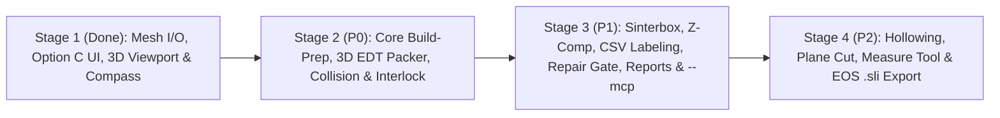

# SolidCraft SLS — Ranked Feature Matrix & Roadmap

Reference baseline: All 12 functional areas from the additive build-preparation reference manual, ranked for **powder-bed SLS manufacturing** (EOS Formiga P110 `160 × 210 × 330 mm`, Farsoon HT403P `400 × 400 × 450 mm`, PA12) in **SolidCraft SLS** (`crates/sls-core` + `apps/solidcraft-sls`).

Related docs: [`docs/sls-nesting-plan.md`](sls-nesting-plan.md) · [`docs/sls-nesting-migration.md`](sls-nesting-migration.md)

---

## Ranking Rubric

| Rank | Tier | Criteria for SLS Powder-Bed Build Preparation |
| :---: | :--- | :--- |
| **`P0`** | **Critical SLS Core** | Mandatory for daily SLS build prep: mesh ingestion, manifold validation, manual & 3D true-shape nesting, exact collision/interlock safety, chamber/metrics overview, and 3MF export. |
| **`P1`** | **High-Value Production** | Major workflow accelerators for batch SLS runs: Sinterboxes / model packages, anisotropic shrinkage scaling, Z-compensation, CSV serial labeling, automatic mesh repair gate, report sheets, and headless `--mcp` API. |
| **`P2`** | **Secondary / Quality-of-Life** | Useful engineering utilities: part hollowing with drain holes, plane/polygon cuts, boolean ops, interactive Z-slice hatching & EOS `.sli` export, and 3D measurement tools. |
| **`P3`** | **Deferred / Non-SLS** | Redundant or irrelevant to powder-bed SLS (e.g., SLA/DLP resin support structures, Kinect depth scanning, UV color/texture painting). |

---

## Complete Ranked Feature Matrix (§1–§12)

> **Status Legend:** `Done` = implemented on `sls-dev` · `Partial` = core present, enhancements pending · `Planned` = not yet implemented.

### §1. Mesh Validity & Diagnostics

| Ref | SolidCraft SLS Feature | Rank | Status | Implementation Target |
| :--- | :--- | :---: | :---: | :--- |
| `1.1–1.2` | Watertight / closedness check (open boundary edges) | **`P0`** | `Planned` | `crates/sls-core/src/manifold.rs` |
| `1.3` | Consistent triangle orientation / winding check | **`P0`** | `Planned` | `crates/sls-core/src/manifold.rs` |
| `1.4` | Self-intersection detection & highlighting | **`P1`** | `Planned` | `crates/sls-core/src/manifold.rs` |

### §2. Workspace, Project Tree & Build Platform

| Ref | SolidCraft SLS Feature | Rank | Status | Implementation Target |
| :--- | :--- | :---: | :---: | :--- |
| `2.1, 5.7` | Hierarchical Project Tree (groups, hide/show, part IDs `#1..#N`, repair/analysis child nodes, context menu) | **`P0`** | `Partial` | `apps/solidcraft-sls` (prototype grouping done; groups/visibility/context menu pending) |
| `2.2, 4.1–4.3` | 3D Viewport (perspective/ortho, floor grid, origin triad, wall-margin zone, 3D View Compass) | **`P0`** | `Done` | `apps/solidcraft-sls/src/viewport.rs` |
| `2.4, 5.9` | Machine Platform presets (Formiga P110, Farsoon HT403P) + Custom Platform editor | **`P0`** | `Partial` | `crates/sls-core/src/model.rs` (presets done; custom dialog pending) |
| `2.5` | File formats: Binary/ASCII STL & Production 3MF (read/write) | **`P0`** | `Done` | `crates/sls-core/src/io/{stl,threemf}.rs` |
| `2.6` | Keyboard shortcuts (view presets, transform, duplicate, pack, collision check) | **`P1`** | `Planned` | `apps/solidcraft-sls` |

### §3. Project Management, Reporting & Export

| Ref | SolidCraft SLS Feature | Rank | Status | Implementation Target |
| :--- | :--- | :---: | :---: | :--- |
| `3.1–3.2.2` | Project lifecycle & multi-part STL/3MF import | **`P0`** | `Partial` | `apps/solidcraft-sls` (single-file picker done; multi-file/folder + project `.scsls` save pending) |
| `3.2.3` | File Preview Browser (dimensions, triangle count, thumbnail before import) | **`P2`** | `Planned` | `apps/solidcraft-sls` |
| `3.2.4, 6.2.4` | Split multi-shell STLs into separate parts | **`P1`** | `Planned` | `crates/sls-core/src/manifold.rs` |
| `3.2.5` | Build Report Sheets (`.pdf` / `.csv` / HTML build summary with metrics & thumbnails) | **`P1`** | `Planned` | `crates/sls-core` + `apps/solidcraft-sls` |
| `3.3` | Export build job to 3MF & export individual/merged parts to STL | **`P0`** | `Partial` | `crates/sls-core/src/io/` (3MF export done; STL writer pending) |
| `3.4` | High-resolution viewport screenshot capture | **`P2`** | `Planned` | `apps/solidcraft-sls` |

### §4. Viewing & Visualization Options

| Ref | SolidCraft SLS Feature | Rank | Status | Implementation Target |
| :--- | :--- | :---: | :---: | :--- |
| `4.1–4.2` | Standard views (`±X, ±Y, ±Z, Iso`), Zoom to Fit, Zoom to Selected | **`P0`** | `Partial` | `apps/solidcraft-sls/src/viewport.rs` (compass snap done; Zoom to Selected + ortho toggle pending) |
| `4.3` | Display modes (shaded, triangle edges, outbox brackets, open-edge highlight, Z-clipping plane) | **`P1`** | `Partial` | `apps/solidcraft-sls/src/viewport.rs` (selected outbox done; edges/Z-clip pending) |
| `4.4` | Mesh vertex color & UV texture viewer | **`P3`** | `Deferred` | — |

### §5. Part Management, Alignment, Collision & 3D Packing

| Ref | SolidCraft SLS Feature | Rank | Status | Implementation Target |
| :--- | :--- | :---: | :---: | :--- |
| `5.1–5.2` | Add/Remove parts & Advanced Selection (by volume, height, shell count, OOB, colliding, invert) | **`P1`** | `Partial` | `apps/solidcraft-sls` (add/remove done; filter selection pending) |
| `5.3` | Standard parametric test library (cubes, cylinders, tensile bars, benchmark shapes) | **`P2`** | `Partial` | `apps/solidcraft-sls` (`Sample Part` bracket done) |
| `5.4` | Duplicate parts (`×N` grid `Nx × Ny × Nz` with configurable X/Y/Z gap) | **`P0`** | `Partial` | `crates/sls-core/src/model.rs` (1D X-step done; 3D grid pending) |
| `5.5.1–5.5.3` | Move, Rotate (`±90°`, Euler, drag-to-translate), Align (to floor `Z=0`, center XY, align faces) | **`P0`** | `Partial` | `crates/sls-core` + `apps/solidcraft-sls` (`Drop Z=0`, `Center XY`, drag done; face-align pending) |
| `5.5.4` | **Anisotropic X/Y/Z Scaling** (PA12 shrinkage compensation factors & unit scale) | **`P0`** | `Planned` | `crates/sls-core/src/model.rs` + Inspector UI |
| `5.5.5` | Outbox 2D/3D Arrange Parts | **`P1`** | `Planned` | `crates/sls-core/src/packer.rs` |
| `5.6` | 2D Planar True-Shape Placement (single-layer Z=0 nesting) | **`P1`** | `Planned` | `crates/sls-core/src/packer.rs` |
| `5.8` | **Platform Overview Table (`F5`)** (ID, status, L×W×H, volume, area, tris, density % + CSV export) | **`P0`** | `Planned` | `apps/solidcraft-sls` |
| `5.10` | **Collision Detection (`Ctrl+K`) & Live Drag Collision Highlight** (`1.0 mm` / `2.5 mm` clearance) | **`P0`** | `Planned` | `crates/sls-core/src/verify.rs` + viewport highlight |
| `5.11.1` | **3D True-Shape Packing** (min part gap, voxel accuracy, Z-step angles, 3D flip, selected-only, height limit `max_Z`, XY border margin) | **`P0`** | `Planned` | `crates/sls-core/src/voxel.rs`, `edt.rs`, `packer.rs` |
| `5.11.1` | **Interlocking Test** (detect non-touching parts trapped inside cavities/loops) | **`P0`** | `Planned` | `crates/sls-core/src/interlock.rs` |
| `5.11.2` | **Model Packages / Sinterboxes** (perforated cages grouping tiny parts for depowdering) | **`P1`** | `Planned` | `crates/sls-core/src/sinterbox.rs` |
| `5.11.2` | Headless Data-API / ERP batch automation (`--mcp` server) | **`P1`** | `Planned` | `apps/solidcraft-sls` + `solidcraft-mcp-server` |

### §6. Part Analysis & Mesh Editing

| Ref | SolidCraft SLS Feature | Rank | Status | Implementation Target |
| :--- | :--- | :---: | :---: | :--- |
| `6.1.1` | Standard Analysis (volume, surface area, dimensions, watertightness, shell count) | **`P0`** | `Partial` | `crates/sls-core/src/{model,manifold}.rs` |
| `6.1.4–6.1.5` | Wall Thickness check & Sintered Thermal/Shadow Area Density Heatmap | **`P1`** | `Planned` | `crates/sls-core/src/thermal.rs` |
| `6.1.2–6.1.3` | Upskin / Downskin surface analysis & Center of Gravity | **`P2`** | `Planned` | `crates/sls-core/src/analysis.rs` |
| `6.2.1–6.2.5` | Simple Editing: Invert normals, Mirror, Convert Units (`mm`↔`in`), Shells to Parts, Merge Parts | **`P1`** | `Planned` | `crates/sls-core/src/mesh_ops.rs` |
| `6.3` | Create Shell / Hollowing (inner wall offset + powder drain holes) | **`P2`** | `Planned` | `crates/sls-core/src/hollow.rs` |
| `6.4–6.5` | Simple Plane Cut (`X/Y/Z` with alignment pins) & Free Polygon Cut | **`P2`** | `Planned` | `crates/sls-core/src/cut.rs` |
| `6.6` | Mesh Boolean Operations (Union, Difference, Intersection) | **`P2`** | `Planned` | `crates/sls-core/src/boolean.rs` |
| `6.7.1, 6.7.3` | **Text Labeling & CSV List Labeling** (emboss/deboss part IDs or serial BOM lists onto parts) | **`P1`** | `Planned` | `crates/sls-core/src/label.rs` |
| `6.7.2` | Image-to-relief labeling | **`P3`** | `Deferred` | — |
| `6.8–6.11` | Triangle Reduction, Mesh Smoothing, Remesh, Mesh Comparison | **`P2`** | `Planned` | `crates/sls-core/src/mesh_ops.rs` |
| `6.12–6.13` | Kinect depth scan import & color/texture imposing | **`P3`** | `Deferred` | — |

### §7. Part Repair & SLS Compensation

| Ref | SolidCraft SLS Feature | Rank | Status | Implementation Target |
| :--- | :--- | :---: | :---: | :--- |
| `7.1–7.6` | Mesh Repair Pipeline (fix flipped normals, stitch open edges, remove degenerate/double faces, close trivial/all holes, wrap internal shells) | **`P1`** | `Planned` | `crates/sls-core/src/repair.rs` |
| `7.7.3` | **Z-Compensation** (trim bottom-layer laser over-cure growth on down-facing surfaces) | **`P1`** | `Planned` | `crates/sls-core/src/compensate.rs` |
| `7.7.6` | Offset Hole Edges (horizontal hole shrinkage compensation) | **`P2`** | `Planned` | `crates/sls-core/src/compensate.rs` |
| `7.7.7–7.7.8` | Surface extrusion & 3D-extrude modeling | **`P3`** | `Deferred` | — |

### §8. Support Structures

| Ref | SolidCraft SLS Feature | Rank | Status | Implementation Target |
| :--- | :--- | :---: | :---: | :--- |
| `8.1–8.4` | SLA/DLP/Metal Support Structures | **`P3`** | `Out of Scope` | Powder-bed PA12 SLS is self-supporting in unfused powder |

### §9. Measuring & Quality Assurance

| Ref | SolidCraft SLS Feature | Rank | Status | Implementation Target |
| :--- | :--- | :---: | :---: | :--- |
| `9.1` | 3D Measuring Tool (point-to-point distance, angles, hole radius/diameter, anchored notes) | **`P2`** | `Planned` | `apps/solidcraft-sls` + `crates/sls-core` |
| `9.2` | Predefined QA inspection test suites | **`P3`** | `Deferred` | — |

### §10. Slice Commander

| Ref | SolidCraft SLS Feature | Rank | Status | Implementation Target |
| :--- | :--- | :---: | :---: | :--- |
| `10.1–10.4` | Interactive Z-Slice Inspector (cross-section preview at layer height `Z`, slice playback) | **`P1`** | `Planned` | `crates/sls-core/src/slice.rs` + viewport clip plane |
| `10.5–10.7` | 2D slice boolean/offset/hatch filling & **EOS `.sli` / CLI slice export** | **`P2`** | `Planned` | `crates/sls-core/src/slice.rs` |

### §11–§12. Settings & Report Templates

| Ref | SolidCraft SLS Feature | Rank | Status | Implementation Target |
| :--- | :--- | :---: | :---: | :--- |
| `11.1–11.3` | Persistent preferences (default machine, clearance, wall margin, PA12 scale factors, theme) | **`P1`** | `Planned` | `apps/solidcraft-sls` |
| `12.1–12.2` | Customizable report template parameters (text/image placeholders) | **`P2`** | `Planned` | `crates/sls-core` |

---

## Ranked Execution Plan (Stages 2–5)

### Stage 2 (`P0`) — Core Build-Prep, 3D EDT Packer, Collision & Interlock Engine
1. **Mesh Diagnostics (`crates/sls-core/src/manifold.rs`):** Watertightness, consistent winding, shell counting, degenerate triangle count.
2. **3D EDT Voxelizer & Packer (`edt.rs`, `voxel.rs`, `packer.rs`):**
   - `u64`-bitpacked `solid_mask` & Felzenszwalb-Huttenlocher 3D EDT `clearance_mask`.
   - Bottom-Left-Back-Fill + multi-start metaheuristic supporting `Fixed`, `ZOnly`, and `Free` (with 3D flip toggle), `max_Z` ceiling limit, selected-only packing, and non-fitting overflow placement outside the chamber.
   - 2D Planar nesting mode (`§5.6`) & 3D grid duplicate (`Nx × Ny × Nz` with X/Y/Z spacing).
3. **Exact Collision & Interlocking Tests (`verify.rs`, `interlock.rs`):**
   - Exact triangle-to-triangle clearance verification (`1.0 mm` / `2.5 mm` configurable) + live collision highlight in the viewport.
   - Topological interlocking detector (ray-escape / translational separability check on cavity-nesting pairs).
4. **Build-Prep Workspace Upgrades (`apps/solidcraft-sls`):**
   - **Platform Overview (`F5`)** modal/table with all part stats + CSV export.
   - **Anisotropic X/Y/Z Scaling** in the Inspector (for PA12 shrinkage compensation) + Custom Machine Platform dialog + Zoom to Selected.

### Stage 3 (`P1`) — SLS Production Automation & Compensation
1. **Sinterbox / Model Packages (`sinterbox.rs`):** Auto-group small parts (`< vol / min_dim`) inside parametric perforated cages for depowdering.
2. **Automatic Mesh Repair Gate (`repair.rs`):** Fix flipped normals, stitch open edges, remove degenerate/duplicate triangles, close holes, and split multi-shell STLs (`Shells to Parts` / `Merge Parts`).
3. **SLS Geometric Compensation & Labeling (`compensate.rs`, `label.rs`):**
   - First-layer **Z-Compensation** (`§7.7.3`), Invert/Mirror/Unit conversion.
   - **CSV List Labeling** & text embossing/debossing for serialized production parts.
4. **Thermal Density Heatmap & Interactive Z-Slice (`thermal.rs`, `slice.rs`):** 3D sliding-box sintered density map (`20×20×20 mm`) + real-time Z-plane cross-section viewer.
5. **Report Sheets & Headless `--mcp` (`apps/solidcraft-sls`):** Exportable build report sheets (`.html` / `.pdf` / `.csv`) + `--mcp` JSON-RPC automation (`load_job`, `nest_job`, `split_builds`, `export_3mf`).

### Stage 4 (`P2`) — Mesh Editing, Measurement & Direct Slicing
1. **Hollowing / Create Shell (`hollow.rs`)** with inner wall offset and powder drain holes + **Wall Thickness** analysis.
2. **Plane & Free Polygon Cutting (`cut.rs`)** with optional alignment dowel pins + **Mesh Booleans / Decimation / Smoothing**.
3. **3D Measuring Tool (`§9.1`):** Point-to-point distance, angle, radius/diameter, and viewport annotations.
4. **2D Slice Offsets, Hatching & EOS `.sli` Export (`§10.5–10.7`).**

### Stage 5 (`P3`) — Deferred / Out-of-Scope
- SLA/DLP support structures (`§8`), Kinect scan capture (`§6.12`), UV texture/image imposing (`§4.4, §6.7.2, §6.13`), and standalone 3D surface modeling (`§7.7.7–7.7.8`).
