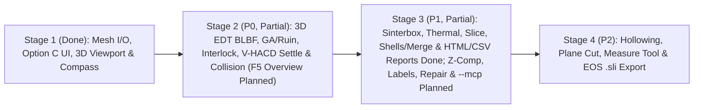

# NestCraft — Ranked Feature Matrix & Roadmap

> **Naming & Scope Note:** Renamed to **NestCraft** (formerly *SolidCraft SLS*) to distinguish it from a slicer and support a broader nesting & build-preparation approach (project file format: **`.nestc`**). Target workspace crates: `crates/nestcraft-core` + `apps/nestcraft` (migrating from initial `crates/sls-core` + `apps/solidcraft-sls`).

Reference baseline: All 12 functional areas from the additive build-preparation reference manual, ranked for **powder-bed SLS manufacturing** (EOS Formiga P110 / P110 Velocis / P100 `200 × 250 × 330 mm`, Farsoon HT403P / SS403P `400 × 400 × 450 mm`, PA12) in **NestCraft** (`crates/nestcraft-core` + `apps/nestcraft`).

Related docs: [`docs/sls-3d-nesting-plan.md`](sls-3d-nesting-plan.md) · [`docs/sls-nesting-plan.md`](sls-nesting-plan.md) · [`docs/sls-nesting-migration.md`](sls-nesting-migration.md)

---

## Ranking Rubric

|       Rank       | Tier                                  | Criteria for SLS Powder-Bed Build Preparation                                                                                                                                                                            |
| :--------------: | :------------------------------------ | :----------------------------------------------------------------------------------------------------------------------------------------------------------------------------------------------------------------------- |
| **`P0`** | **Critical SLS Core**           | Mandatory for daily SLS build prep: mesh ingestion, manifold validation, manual & 3D true-shape nesting, exact collision/interlock safety, chamber/metrics overview, and 3MF export.                                     |
| **`P1`** | **High-Value Production**       | Major workflow accelerators for batch SLS runs: Sinterboxes / model packages, anisotropic shrinkage scaling, Z-compensation, CSV serial labeling, automatic mesh repair gate, report sheets, and headless `--mcp` API. |
| **`P2`** | **Secondary / Quality-of-Life** | Useful engineering utilities: part hollowing with drain holes, plane/polygon cuts, boolean ops, interactive Z-slice hatching & EOS `.sli` export, and 3D measurement tools.                                            |
| **`P3`** | **Deferred / Non-SLS**          | Redundant or irrelevant to powder-bed SLS (e.g., SLA/DLP resin support structures, Kinect depth scanning, UV color/texture painting).                                                                                    |

---

## Complete Ranked Feature Matrix (§1–§12)

> **Status Legend:** `Done` = implemented on `sls-dev` · `Partial` = core present, enhancements pending · `Planned` = not yet implemented.

### §1. Mesh Validity & Diagnostics

| Ref          | NestCraft Feature                                   |       Rank       |   Status   | Implementation Target                     |
| :----------- | :-------------------------------------------------- | :--------------: | :---------: | :---------------------------------------- |
| `1.1–1.2` | Watertight / closedness check (open boundary edges) | **`P0`** |  `Done`   | `crates/nestcraft-core/src/manifold.rs` |
| `1.3`      | Consistent triangle orientation / winding check     | **`P0`** |  `Done`   | `crates/nestcraft-core/src/manifold.rs` |
| `1.4`      | Self-intersection detection & highlighting          | **`P1`** | `Planned` | `crates/nestcraft-core/src/manifold.rs` |

### §2. Workspace, Project Tree & Build Platform

| Ref               | NestCraft Feature                                                                                             |       Rank       |   Status   | Implementation Target                                                                |
| :---------------- | :------------------------------------------------------------------------------------------------------------ | :--------------: | :---------: | :----------------------------------------------------------------------------------- |
| `2.1, 5.7`      | Compact Project Tree & Split Sidebars (left: `Build Parts Browser` with 20×20 3D thumbnails, groups, hide/show, transparency, color picker, context menu + `Selected Part` config/info; right: `Build Summary`, `Build Chamber`, `No-Build Zone`; draggable pop-up modals) | **`P0`** |  `Done`   | `apps/nestcraft` |
| `2.2, 4.1–4.3` | 3D Viewport (`MovingLayer` fast multi-part drag & rotation, `Z=0` floor grid, bed envelope, Front-Left default view with `+X` right / `+Y` far, Perspective/Isometric toggle, 360° orbit, middle-pan, marquee select, face hover highlight, centerpoint drag handle, toggleable world-axis `X/Y/Z` ring rotation gizmo, bottom-right Mesh Repair Gate badge, model context menu, 3D View Compass) | **`P0`** |  `Done`  | `apps/nestcraft/src/{viewport,ui_viewport}.rs` |
| `2.4, 5.9`      | Machine Platform presets (5 predefined: `Formiga P110`, `P110 Velocis`, `P100` `200×250×330` Front-Left; `Farsoon HT403P`, `SS403P` `400×400×450` Center; plus `Custom`) with configurable size, origin, wall distance, Min Z & per-machine persistent No-Build Zone (all slots except `P100`; exact 3D mesh-to-mesh distance check) | **`P0`** |  `Done`   | `crates/nestcraft-core/src/model.rs` + `apps/nestcraft`                              |
| `2.5`           | File formats: Binary/ASCII STL (read/write), Production 3MF (read/write) & `.nestc` v2 project archive (SHA-256 content-addressed lossless binary `.nmesh` entries, dedup/pruning, async save progress, filename convention & quick-save; v1 readable) | **`P0`** |  `Done`  | `crates/nestcraft-core/src/io/{stl,threemf,nestc}.rs`                              |
| `2.6`           | Keyboard shortcuts (`Ctrl+Z`/`Ctrl+Y` unlimited undo/redo, `X`/`Y`/`Z` ±45° rotate, `Ctrl+Down` Z-snap, `R` +90°, `C` center XY, `H` hide, `L` lock, `M` move, `Ctrl+D` dup, `Ctrl+S` scale, `Ctrl+Shift+S` save bed, `Ctrl+K` collision check, `Del` delete, `Arrows`/`PgUp`/`PgDn` nudge, `Space` view cycle, `1`/`3`/`7`/`0`/`F` camera views, `Esc` cancel) | **`P1`** | `Partial` | `apps/nestcraft` (undo/redo/rotate/snap/center/view/move/nudge/dup/scale/del/hide/lock/save/collision done; Auto-Nest shortcut pending) |

### §3. Project Management, Reporting & Export

| Ref              | NestCraft Feature                                                                        |       Rank       |   Status   | Implementation Target                                                                             |
| :--------------- | :--------------------------------------------------------------------------------------- | :--------------: | :---------: | :------------------------------------------------------------------------------------------------ |
| `3.1–3.2.2`   | Project lifecycle (`.nestc` save/open), parallel multi-threaded STL/3MF import, model-location import with below-`Z=0` prompt, **Failed Print Recovery** (`Failed Print?` Z-height inspection, reprint CSV & reprint job extraction) | **`P0`** |  `Done`   | `crates/nestcraft-core/src/{io/nestc,recovery}.rs` + `apps/nestcraft`                             |
| `3.2.3`        | File Preview Browser (dimensions, triangle count, thumbnail before import)               | **`P2`** | `Planned` | `apps/nestcraft`                                                                                |
| `3.2.4, 6.2.4` | Split multi-shell STLs into separate parts (`Shells to Parts` with Keep/Delete Original prompt) | **`P1`** |  `Done`   | `crates/nestcraft-core/src/manifold.rs` + `apps/nestcraft` |
| `3.2.5`        | Build Report Sheets (`.html` / `.csv` mockup with immediate open, inside-machine filter, selected machine & Build Chamber material selector; `.pdf` pending) | **`P1`** | `Partial` | `crates/nestcraft-core/src/report.rs` + `apps/nestcraft`                                                    |
| `3.3`          | Export build job to 3MF & export individual/selected parts to STL (with context menu)    | **`P0`** |  `Done`   | `crates/nestcraft-core/src/io/{threemf,stl}.rs` + `apps/nestcraft`                                |
| `3.4`          | High-resolution viewport screenshot capture                                              | **`P2`** | `Planned` | `apps/nestcraft`                                                                                |

### §4. Viewing & Visualization Options

| Ref          | NestCraft Feature                                                                              |       Rank       |    Status    | Implementation Target                                                                           |
| :----------- | :--------------------------------------------------------------------------------------------- | :--------------: | :----------: | :---------------------------------------------------------------------------------------------- |
| `4.1–4.2` | Standard views (`Space` cycle), View banner (`Zoom to All Parts`, `Zoom to Selected`, `Zoom to Platform`, `Zoom to All`, `Zoom to Selection` right-drag rect) | **`P0`** | `Done` | `apps/nestcraft/src/viewport.rs` + `apps/nestcraft/src/main.rs` |
| `4.3`      | Display modes (shaded, 50% per-part transparency, per-part RGB color picker, outbox brackets, coplanar face highlight, Z-clipping plane) | **`P1`** | `Partial` | `apps/nestcraft/src/viewport.rs` (50% transparency, RGB color, outbox & face highlight done; edges/Z-clip pending) |
| `4.4`      | Mesh vertex color & UV texture viewer                                                          | **`P3`** | `Deferred` | —                                                                                              |

### §5. Part Management, Alignment, Collision & 3D Packing

| Ref              | NestCraft Feature                                                                                                                               |       Rank       |   Status   | Implementation Target                                                                                       |
| :--------------- | :---------------------------------------------------------------------------------------------------------------------------------------------- | :--------------: | :---------: | :---------------------------------------------------------------------------------------------------------- |
| `5.1–5.2`     | Add/Remove parts, Multi-select (`Ctrl+Click`, `Shift+Click` tree range, marquee drag) & Metric Filter Selection | **`P1`** | `Partial` | `apps/nestcraft` (add/remove & multi-select done; metric filter selection pending)                          |
| `5.3`          | Standard parametric test library (cubes, cylinders, tensile bars, benchmark shapes)                                                             | **`P2`** | `Partial` | `crates/nestcraft-core` / `apps/nestcraft` (`Sample Part` bracket done)                                    |
| `5.4`          | Duplicate parts (`×N` grid `Nx × Ny × Nz` with configurable X/Y/Z gap & compact distribution)                                                 | **`P0`** |  `Done`   | `crates/nestcraft-core/src/model.rs` + `Duplicate Parts` popup in `apps/nestcraft`                          |
| `5.5.1–5.5.3` | Move (`Relative`/`Absolute`, multi-part `MovingLayer` drag), Rotate (centroid-preserving `±45°`/`±90°`/Euler), Align (`Align Face to -Z`, `Drop Min Z`, `Center XY`) | **`P0`** | `Done` | `crates/nestcraft-core/src/model.rs` + `apps/nestcraft` |
| `5.5.4`        | **Anisotropic X/Y/Z Scaling** (`Ctrl+S` popup: Uniform/Per-Axis, Percent/Absolute/Factor, `in ↔ mm` unit scale, Keep Open & Reset) | **`P0`** | `Done` | `crates/nestcraft-core/src/model.rs` (`scale_instance`) + `apps/nestcraft` |
| `5.5.5`        | Outbox 2D/3D Arrange Parts                                                                                                                      | **`P1`** | `Planned` | `crates/nestcraft-core/src/packer.rs`                                                                     |
| `5.6`          | 2D Planar True-Shape Placement (multi-threaded Bottom-Left-Fill with OBB orientation, optional `Use Minimum X/Y Bounding Box`, `To Platform` / `In Place (Outside)`, `Accurate ↔ Fast` resolution slider & NBZ avoidance) | **`P1`** | `Done` | `crates/nestcraft-core/src/nest2d.rs` + `apps/nestcraft` |
| `5.8`          | **Platform Overview Table (`F5`)** (ID, status, L×W×H, volume, area, tris, density % + CSV export)                                    | **`P0`** | `Planned` | `apps/nestcraft`                                                                                          |
| `5.10`         | **Collision Detection (`Ctrl+K`) & Incremental Overlap Highlight** (`1.0 mm` / `2.5 mm` configurable clearance, incremental `CollisionCache`, exact mesh-to-mesh clearance check & yellow 3D overlap voxel/quad/seam viewport highlight)                                  | **`P0`** | `Done` | `crates/nestcraft-core/src/collision.rs` + `apps/nestcraft`                                                |
| `5.11.1`       | **3D True-Shape Packing & Gravity Settle** (Stage 1 multi-order 3D BLBF over `u64` flood-fill & Felzenszwalb-Huttenlocher 3D EDT masks with live viewport streaming, `2.0 ↔ 0.5 mm` resolution, `Per-Part` / `Override All` orientation mode with `XY Rotation` & `Z Rotation` step sliders including `0° (Locked)` + conditional `PCA / OBB Pre-Alignment`, anisotropic XY/Z & adaptive part-mass clearance, Z-ceiling, `+X` overflow, `selected_only` / `keep_in_bounds_fixed`, `sysinfo` RAM & CPU guardrails, Stage 2 parallel island GA / Ruin-and-Recreate & thermal/slice refinement, Stage 3 & standalone `Gravity Settle` via `rapier3d`/`parry3d` V-HACD, compact fixed-width scrollable configuration modals, non-blocking bottom progress bar & `Stop & Apply Best`) | **`P0`** | `Done` | `crates/nestcraft-core/src/{voxel,nest3d,compact}.rs` + `apps/nestcraft` |
| `5.11.1`       | **Interlocking Test** (open-cavity-safe AABB pre-filter + 6/14-dir swept escape + bounded voxel BFS + sequential peeling check integrated into 3D nesting & Gravity Settle; standalone `Analyze` diagnostic button pending)                                                           | **`P0`** | `Done` | `crates/nestcraft-core/src/interlock.rs`                                                                  |
| `5.11.2`       | **Model Packages / Sinterboxes** (`Box` & `Tight Fit` stepped cages, auto window sizing from min XYZ, adaptive `0.8–1.0 mm` bars, largest-panel 3D label, auto-grouping & single-part multiply suggestion) | **`P1`** |  `Done`   | `crates/nestcraft-core/src/sinterbox.rs` + `apps/nestcraft`                                               |
| `5.11.2`       | Headless Data-API / ERP batch automation (`--mcp` server)                                                                                     | **`P1`** | `Planned` | `apps/nestcraft` + `solidcraft-mcp-server`                                                              |

### §6. Part Analysis & Mesh Editing

| Ref              | NestCraft Feature                                                                                    |       Rank       |    Status    | Implementation Target                             |
| :--------------- | :--------------------------------------------------------------------------------------------------- | :--------------: | :----------: | :------------------------------------------------ |
| `6.1.1`        | Standard Analysis & `Analyze` banner (volume, surface area, dimensions, watertightness, shell count, bottom-right Mesh Repair Gate badge; active `Slice Distribution`, `Thermal Map` & `Collision Check`; placeholders: `Stair Highlight`, `Measure`, `Wall Thickness`, `Up / Downskin`, `Shadow Area`) | **`P0`** | `Partial` | `crates/nestcraft-core/src/{model,manifold,slice,thermal,collision}.rs` + `apps/nestcraft/src/{ui_bars,ui_build_panel,ui_viewport}.rs` |
| `6.1.4–6.1.5` | Wall Thickness check & Sintered Thermal/Shadow Area Density Heatmap (`20×20×20 mm` sliding-box 3D Thermal Map + viewport coloring done; Wall Thickness & Shadow Area pending) | **`P1`** | `Partial` | `crates/nestcraft-core/src/thermal.rs` + `apps/nestcraft` |
| `6.1.2–6.1.3` | Upskin / Downskin surface analysis & Center of Gravity                                               | **`P2`** | `Planned` | `crates/nestcraft-core/src/analysis.rs`         |
| `6.2.1–6.2.5` | Simple Editing (`Edit` banner): Invert normals, Mirror, Convert Units (`mm`↔`in`), `Shells to Parts`, `Merge Parts` (with Keep/Delete Original prompt), plus placeholder buttons (`Shell`, `Labels`, `Repair Mesh`, `Boolean`, `Cut / Split`, `Offset`) | **`P1`** | `Partial` | `crates/nestcraft-core/src/model.rs` + `apps/nestcraft` (`Shells to Parts`, `Merge Parts` & `mm↔in` unit scale done; invert/mirror & 6 Edit banner placeholders pending) |
| `6.3`          | Create Shell / Hollowing (inner wall offset + powder drain holes)                                    | **`P2`** | `Planned` | `crates/nestcraft-core/src/hollow.rs`           |
| `6.4–6.5`     | Simple Plane Cut (`X/Y/Z` with alignment pins) & Free Polygon Cut                                  | **`P2`** | `Planned` | `crates/nestcraft-core/src/cut.rs`              |
| `6.6`          | Mesh Boolean Operations (Union, Difference, Intersection)                                            | **`P2`** | `Planned` | `crates/nestcraft-core/src/boolean.rs`          |
| `6.7.1, 6.7.3` | **Text Labeling & CSV List Labeling** (emboss/deboss part IDs or serial BOM lists onto parts)  | **`P1`** | `Planned` | `crates/nestcraft-core/src/label.rs`            |
| `6.7.2`        | Image-to-relief labeling                                                                             | **`P3`** | `Deferred` | —                                                |
| `6.8–6.11`    | Triangle Reduction, Mesh Smoothing, Remesh, Mesh Comparison                                          | **`P2`** | `Planned` | `crates/nestcraft-core/src/mesh_ops.rs`         |
| `6.12–6.13`   | Kinect depth scan import & color/texture imposing                                                    | **`P3`** | `Deferred` | —                                                |

### §7. Part Repair & SLS Compensation

| Ref              | NestCraft Feature                                                                                                                            |       Rank       |    Status    | Implementation Target                       |
| :--------------- | :------------------------------------------------------------------------------------------------------------------------------------------- | :--------------: | :----------: | :------------------------------------------ |
| `7.1–7.6`     | Mesh Repair Pipeline (fix flipped normals, stitch open edges, remove degenerate/double faces, close trivial/all holes, wrap internal shells) | **`P1`** | `Planned` | `crates/nestcraft-core/src/repair.rs`     |
| `7.7.3`        | **Z-Compensation** (trim bottom-layer laser over-cure growth on down-facing surfaces)                                                  | **`P1`** | `Planned` | `crates/nestcraft-core/src/compensate.rs` |
| `7.7.6`        | Offset Hole Edges (horizontal hole shrinkage compensation)                                                                                   | **`P2`** | `Planned` | `crates/nestcraft-core/src/compensate.rs` |
| `7.7.7–7.7.8` | Surface extrusion & 3D-extrude modeling                                                                                                      | **`P3`** | `Deferred` | —                                          |

### §8. Support Structures

| Ref          | NestCraft Feature                |       Rank       |      Status      | Implementation Target                                    |
| :----------- | :------------------------------- | :--------------: | :--------------: | :------------------------------------------------------- |
| `8.1–8.4` | SLA/DLP/Metal Support Structures | **`P3`** | `Out of Scope` | Powder-bed PA12 SLS is self-supporting in unfused powder |

### §9. Measuring & Quality Assurance

| Ref     | NestCraft Feature                                                                         |       Rank       |    Status    | Implementation Target                          |
| :------ | :---------------------------------------------------------------------------------------- | :--------------: | :----------: | :--------------------------------------------- |
| `9.1` | 3D Measuring Tool (point-to-point distance, angles, hole radius/diameter, anchored notes) | **`P2`** | `Planned` | `apps/nestcraft` + `crates/nestcraft-core` |
| `9.2` | Predefined QA inspection test suites                                                      | **`P3`** | `Deferred` | —                                             |

### §10. Slice Commander

| Ref            | NestCraft Feature                                                                           |       Rank       |    Status    | Implementation Target                                        |
| :------------- | :------------------------------------------------------------------------------------------ | :--------------: | :----------: | :----------------------------------------------------------- |
| `10.1–10.4` | Interactive Z-Slice Inspector (`Slice Distribution` collapsible/widenable sidebar with exact XY sintered area at `0.1–5.0 mm` step done; viewport clip plane & playback pending) | **`P1`** | `Partial` | `crates/nestcraft-core/src/slice.rs` + `apps/nestcraft/src/ui_build_panel.rs` |
| `10.5–10.7` | 2D slice boolean/offset/hatch filling & **EOS `.sli` / CLI slice export**           | **`P3`** | `Deferred` | `crates/nestcraft-core/src/slice.rs`                       |

### §11–§12. Settings & Report Templates

| Ref            | NestCraft Feature                                                                           |       Rank       |   Status   | Implementation Target     |
| :------------- | :------------------------------------------------------------------------------------------ | :--------------: | :---------: | :------------------------ |
| `11.1–11.3` | Persistent preferences (default machine, clearance, wall margin, PA12 scale factors, theme) | **`P1`** | `Partial` | `apps/nestcraft` (`machines.json` all-slot presets for size/origin/wall margin/Min Z/clearance/material & per-machine No-Build Zone persistence done; default startup slot, PA12 scale factors & theme persistence pending) |
| `12.1–12.2` | Customizable report template parameters (text/image placeholders)                           | **`P2`** | `Planned` | `crates/nestcraft-core` |

---

## Ranked Execution Plan (Stages 2–5)

### Stage 2 (`P0`) — Core Build-Prep, 3D EDT Packer, Collision & Interlock Engine

> See [`docs/sls-3d-nesting-plan.md`](sls-3d-nesting-plan.md) for the detailed 3D nesting & gravity compaction architecture.

1. **Mesh Diagnostics (`crates/nestcraft-core/src/manifold.rs` — `Done`):** Watertightness, consistent winding, shell counting, degenerate triangle count.
2. **3D EDT Voxelizer, Packer & Gravity Compaction (`voxel.rs`, `nest3d.rs`, `compact.rs` — `Done`):**
   - `u64`-bitpacked `solid_mask` & Felzenszwalb-Huttenlocher 3D EDT `clearance_mask` (`voxel.rs` — `Done`) with anisotropic XY/Z & adaptive part-mass (`r_A + r_B`) clearance, PCA/OBB pre-alignment, coarse-first symmetry pruning, and CPU/RAM guardrails.
   - Multi-order parallel 3D Bottom-Left-Back-Fill (`nest3d.rs` — `Done`) supporting `Per-Part` / `Override All` orientation mode with `XY Rotation` (`0° (Locked)`..`30°`) and `Z Rotation` (`0° (Locked)`..`15°`) step sliders and conditional `PCA / OBB Pre-Alignment`, `max_z_limit_mm` ceiling, `selected_only` + `keep_in_bounds_fixed`, `+X` overflow placement, live viewport streaming, and Stage 2 anytime parallel island GA / Ruin-and-Recreate with thermal/slice refinement (`Done` — Phase 4).
   - Stage 3 & standalone `Gravity Settle` continuous physics compaction (`compact.rs` via `rapier3d` + `parry3d` V-HACD — `Done`) + non-blocking bottom progress bar with `Stop & Apply Best` / `Cancel` (`Done`).
   - 2D Planar nesting mode (`§5.6`, `nest2d.rs` — `Done`) & 3D grid duplicate (`Nx × Ny × Nz` with X/Y/Z spacing — `Done`).
3. **Exact Collision & Interlocking Tests (`collision.rs`, `interlock.rs` — `Done`):**
   - Exact mesh-to-mesh clearance verification (`collision.rs` incremental `CollisionCache`, `Ctrl+K` yellow 3D overlap voxel/quad/seam highlight — `Done`) + final exact clearance gate before committing 3D nest/settle results (`Done`).
   - Open-cavity-safe topological interlocking detector (`interlock.rs` AABB + 14-dir swept escape + bounded voxel BFS + sequential peeling — `Done`; standalone `Analyze` diagnostic button `Planned`).
4. **Build-Prep Workspace Upgrades (`apps/nestcraft` — `Partial`):**
   - **Platform Overview (`F5`)** modal/table with all part stats + CSV export (`Planned`).
   - **Anisotropic X/Y/Z Scaling** (`Done`), Custom Machine Platform dialog & 5 predefined SLS machines (`Done`), and Zoom to Selected (`Done`).

### Stage 3 (`P1`) — SLS Production Automation & Compensation

1. **Sinterbox / Model Packages (`sinterbox.rs` — `Done`):** Auto-group small parts (`< vol / min_dim`) inside parametric perforated cages for depowdering.
2. **Automatic Mesh Repair Gate (`repair.rs` — `Planned`; `Shells to Parts` & `Merge Parts` `Done`):** Fix flipped normals, stitch open edges, remove degenerate/duplicate triangles, close holes, and split/merge multi-shell STLs.
3. **SLS Geometric Compensation & Labeling (`compensate.rs`, `label.rs` — `Planned`):**
   - First-layer **Z-Compensation** (`§7.7.3`), Invert/Mirror/Unit conversion.
   - **CSV List Labeling** & text embossing/debossing for serialized production parts.
4. **Thermal Density Heatmap & Interactive Z-Slice (`thermal.rs`, `slice.rs` — `Partial`: 3D Thermal Map & Slice Distribution sidebar `Done`; viewport clip plane `Planned`):** 3D sliding-box sintered density map (`20×20×20 mm`) + real-time Z-plane cross-section viewer.
5. **Report Sheets & Headless `--mcp` (`report.rs` — `Partial`: HTML/CSV `Done`; PDF & `--mcp` `Planned`):** Exportable build report sheets (`.html` / `.pdf` / `.csv`) + `--mcp` JSON-RPC automation (`load_job`, `nest_job`, `split_builds`, `export_3mf`).
   - *Build Report Status (`report.rs`, quoting reference in `C:\Users\Degamim-I9\Desktop\SLS_wiki\raw\tools\quoting_editor`):*
     1. Inside-machine filtering (excluding overflow/out-of-bounds parts) — **`Done`**.
     2. Machine-based report metrics, pricing & powder/build calculations (`data/machines.js`: `bedX`, `bedY`, `pillowZ`, `machineCost`, `defaultBuildRate`) + HTML/CSV export with immediate open — **`Done`** (`.pdf` & Netfabb XML export `Planned`).
     3. Build Chamber **`Select Material`** selector (`PA 2200`, `FS3300PA`, `PA2210FR`, `FS3401GB`, `PBT-01`, `PA3200GB` + `MATERIAL_PROFILES` parameters) — **`Done`**.

### Stage 4 (`P2`) — Mesh Editing, Measurement & Direct Slicing

1. **Hollowing / Create Shell (`hollow.rs`)** with inner wall offset and powder drain holes + **Wall Thickness** analysis.
2. **Plane & Free Polygon Cutting (`cut.rs`)** with optional alignment dowel pins + **Mesh Booleans / Decimation / Smoothing**.
3. **3D Measuring Tool (`§9.1`):** Point-to-point distance, angle, radius/diameter, and viewport annotations.
4. **2D Slice Offsets, Hatching & EOS `.sli` Export (`§10.5–10.7`).**

### Stage 5 (`P3`) — Deferred / Out-of-Scope

- SLA/DLP support structures (`§8`), Kinect scan capture (`§6.12`), UV texture/image imposing (`§4.4, §6.7.2, §6.13`), and standalone 3D surface modeling (`§7.7.7–7.7.8`).
