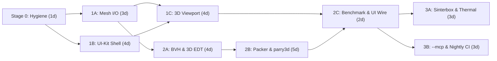

# NestCraft 3D Nesting — Staged Implementation Plan (UI-First)

> **Naming & Project Format:** Renamed to **NestCraft** (formerly *SolidCraft SLS*) to distinguish it from a slicer and support a broader 3D/2D nesting & build-preparation approach. Project file format: **`.nestc`** (replacing `.scsls`). Target workspace crates: `crates/nestcraft-core` (`nestcraft-core`) + `apps/nestcraft` (`nestcraft`), migrating from initial Stage 0–1 names (`crates/sls-core` + `apps/solidcraft-sls`).

Reference architecture: [`docs/sls-nesting-migration.md`](sls-nesting-migration.md) · Ranked feature scope: [`docs/sls-feature-matrix.md`](sls-feature-matrix.md) *(Note: reordered from the migration doc to build minimal Mesh I/O + UI viewport first for visual feedback, then the headless 3D EDT packer.)*

---

## Baseline Observations & Prerequisites

Before starting implementation, three repository/environment details were verified against the current `sls-dev` workspace:

1. **Branch & Workspace:** Currently on `sls-dev`. Root `Cargo.toml` (`v0.46.2`, Rust 2024 edition, MSRV `1.95`) globs `crates/*` and `apps/*` and enforces `unsafe_code = "forbid"`.
2. **External Dependencies to Vet:** `parry3d` is not currently in `Cargo.lock` or `Cargo.toml`. Adding it (or `nalgebra`) requires passing `cargo xtask licences --check` and wasm compatibility checks.
3. **`ferroform` Source & Toolchain:**
   - `ferroform` (pure Rust, replacing `pyroid`) lives in the same directory (`raw/projects/GitHub/ferroform` / `https://github.com/yuvalabou/ferroform`). In Stage 2A, we can either pull `ferroform` from that local/GitHub repo or vendor/port its pure-Rust `bvh`, `edt`, and `manifold` modules into `crates/nestcraft-core`.
   - Running `cargo xtask layers` attempted an online rustup sync for `1.99.1-x86_64-pc-windows-msvc`, so local toolchain availability must be confirmed first.

---

## Stage 0 — Workspace, Toolchain & Layering Hygiene

**Goal:** Establish a clean, CI-passing skeleton for the two new crates without touching `apps/solidcraft/`, `crates/engine/`, or `crates/look/`.

### Detailed Tasks
1. **Toolchain Verification:**
   - Check installed `rustup toolchain list` and confirm the workspace's pinned toolchain is available offline so `cargo xtask` commands run without network sync failures.
2. **Scaffold `crates/nestcraft-core`:**
   - Create `crates/nestcraft-core/Cargo.toml` inheriting `version.workspace = true`, `edition.workspace = true`, `license.workspace = true`, `rust-version.workspace = true`, and `[lints] workspace = true`.
   - Create `crates/nestcraft-core/src/lib.rs` with `#![deny(clippy::unwrap_used, clippy::expect_used, clippy::panic, clippy::unimplemented, clippy::todo, clippy::unreachable)]` and a `thiserror = "2"` error enum (`NestCraftError`).
   - Keep dependencies strictly pure-Rust / non-UI (`thiserror`, `serde`, `zip`, `quick-xml`, `rayon` when needed).
3. **Scaffold `apps/nestcraft`:**
   - Create `apps/nestcraft/Cargo.toml` and `apps/nestcraft/src/main.rs` with a minimal entry point.
4. **Register in Layering & Asset Gates:**
   - Add `("nestcraft-core", Class::Shared)` and `("nestcraft", Class::Exempt)` to `xtask/src/layers.rs::TABLE`.
   - Create `attribution/pending/nestcraft.md` with the standard attribution table header so future NestCraft assets pass `cargo xtask assets` without merge conflicts on `ATTRIBUTION.md`.

### Exit Criteria
- `cargo xtask layers`, `cargo xtask ui-containers`, `cargo xtask assets`, and `cargo check -p nestcraft-core -p nestcraft` all pass.

---

## Stage 1 — Minimal Mesh I/O + `solidcraft-ui-kit` & `viewport-gpu` Desktop App

**Goal:** Stand up the interactive 3D SLS build-volume viewer first—proving SolidCraft's UI-kit, icon extension, and GPU instancing integration while enabling visual inspection for all later packer work.

### Stage 1A — Minimal `nestcraft-core` Mesh I/O & Machine Definitions
- **Data Model (`crates/nestcraft-core/src/model.rs`):**
  - `TriMesh`: indexed or soup triangle mesh (`positions: Vec<[f32; 3]>`, `indices: Vec<[u32; 3]>`, `normals`, `bounds: [[f32; 3]; 2]`, `volume_mm3`, `surface_area_mm2`), convertible to `solidcore_tess::Mesh` / `SharedTris` at the UI boundary.
  - `PartId`, `PartPrototype` (unique mesh + default constraints), and `PartInstance` (`part_id`, rigid `3×4` row-major transform `[[f32; 4]; 3]`, `RotationConstraint::{Free, ZOnly, Fixed}`, `locked: bool`).
  - `MachineProfile`: EOS Formiga P110 (`160.0 × 210.0 × 330.0 mm`) and Farsoon HT403P (`400.0 × 400.0 × 450.0 mm`), plus configurable wall margins and default part-to-part clearance (`2.5 mm`).
  - `BuildJob`: machine profile, list of `PartPrototype`s, list of `PartInstance`s, and job metrics (`part_count`, `total_part_volume`, `bounding_z_mm`, `packing_density_pct`).
- **Mesh I/O (`crates/nestcraft-core/src/io/`):**
  - `stl.rs`: Binary STL (80-byte header + triangle count + 50-byte records) and ASCII STL (`solid` / `facet normal` / `vertex`) reader, with strict bounds/NaN/infinite-vertex validation (`Result`, no `unwrap`).
  - `threemf.rs`: Pure-mesh 3MF reader/writer using `zip = "9"` + `quick-xml = "0.41"`, supporting `3D/3dmodel.model`, Production Extension `p:path` external object references, and `<item objectid="..." transform="...">` 3×4 affine matrices (modeled on `crates/io/src/threemf.rs` without pulling in `solidcraft-doc`).

### Stage 1B — App Shell, Theme & Zero-Touch Icons (`apps/nestcraft`)
- **Startup Initialization (`apps/nestcraft/src/main.rs`):**
  - Define `static NESTCRAFT_ICONS: IconSet = IconSet::extended(solidcraft_look::icons::DATA, IconExtension { masters: &[], aliases: &[...], icon_accents: &[] })` mapping the 10 semantic actions (`sls_import_mesh`, `sls_auto_nest`, `sls_sinterbox`, `sls_orient_lock`, `sls_duplicate`, `sls_emboss_id`, `sls_hollow`, `sls_slice_z`, `sls_collision`, `sls_thermal_map`) to existing `crates/look/icons/design/svg/model/` masters.
  - Call `solidcraft_look::glyphs::install()`, `solidcraft_look::themes::install()`, `solidcraft_ui_kit::icons::install(&NESTCRAFT_ICONS)`, and `solidcraft_look::fonts::install(&ctx)` — **never** calling `solidcraft_look::install(&ctx)` so `OnceLock` does not lock out `&NESTCRAFT_ICONS`.
- **UI Layout & Module Split (`apps/nestcraft/src/`):**
  - Modularized across `main.rs`, `app.rs`, `ui_bars.rs`, `ui_parts_panel.rs`, `ui_build_panel.rs`, `ui_modals.rs`, `ui_viewport.rs`, `viewport.rs`, `icons.rs`, and `tests.rs`.
  - Route every window, panel, ribbon, menu, and tooltip through `solidcraft_ui_kit::Container` and `BackingTooltipExt` (`cargo xtask ui-containers` compliant), with draggable pop-up modals (`movable(true)`).
  - **Top Banner:** Machine selector (5 predefined SLS machines `P110` / `P110 Velocis` / `P100` / `HT403P` / `SS403P` + `Custom` & `Configure...`), Open/Save `.nestc`, Generate Report (HTML/CSV export & immediate open), Import STL/3MF, **Failed Print?** (partial-build recovery by aborted Z height with reprint job & CSV export), Sample Part, Export 3MF / STLs, Auto-Nest (opens 3D Nesting modal), Fit View, Theme toggle.
  - **Edit Banner:** Part-editing actions (`Move`, `Scale`, `Duplicate`, `Drop Z=0`, `Delete`, `Align`, `Shells to Parts`, `Merge Parts` with Keep/Delete Original prompt) plus placeholder mesh tools (`Shell`, `Labels`, `Repair Mesh`, `Boolean`, `Cut / Split`, `Offset`).
  - **Nest Banner:** **2D Nesting** (`crates/nestcraft-core/src/nest2d.rs` — multi-threaded `u64` bitmask Bottom-Left-Fill with `To Platform` / `In Place (Outside)`, `Accurate ↔ Fast` resolution slider, OBB orientation candidate, optional `Use Minimum X/Y Bounding Box`, `No-Build Zone` avoidance, and `+X` overflow strip), **3D Nesting** (`crates/nestcraft-core/src/nest3d.rs` — Stage 1 BLBF + Stage 2 parallel island GA/Ruin-and-Recreate + Stage 3 V-HACD gravity settle, `XY`/`Z` rotation sliders with `0° (Locked)`), and standalone **Gravity Settle** (`crates/nestcraft-core/src/compact.rs`).
  - **Analyze Banner:** `Slice Distribution` (collapsible, widenable right sidebar showing exact Z-layer sintered XY area `mm²` & bed fill `%` at `0.1 / 0.5 / 1.0 / 2.0 / 5.0 mm` step with `Peak | Bed %` full-width scaling), `Thermal Map` (`20×20×20 mm` 3D sliding-box sintered density coloring in viewport + collapsible risk sidebar), `Collision Check` (`Ctrl+K`, incremental `CollisionCache` & yellow 3D overlap voxel/quad/seam highlight), plus placeholder analysis tools (`Stair Highlight`, `Measure`, `Wall Thickness`, `Up / Downskin`, `Shadow Area`).
  - **View Banner:** `Zoom to All Parts`, `Zoom to Selected`, `Zoom to Platform`, `Zoom to All`, `Zoom to Selection` (right-drag rect), and `Perspective / Isometric` projection toggle (with Front-Left default view: `+X` right, `+Y` far).
  - **Left Sidebar (Part Scope):** Aerated `Build Parts Browser` (groups, 20×20 thumbnails, visibility/transparency/lock/color, context menu) + `Selected Part` configuration and metrics.
  - **Right Sidebar (Build Scope):** Aerated `Build Summary` (counts, volume, surface area, Z height/layers, density, floor/NBZ warnings), `Build Chamber` (machine, origin, margins, clearance), and `No-Build Zone`.
  - **3D Viewport Overlays & Handles:** Selected part centerpoint drag handle (`Grab` cursor), left-front bounding-box toggleable world-axis (`X`/`Y`/`Z`) ring rotation gizmo (`MovingLayer` live update, continuous rotation without floor clamping or snapping), and bottom-right Mesh Repair Gate badge (clickable to select faulty parts).

### Stage 1C — Instanced 3D Viewport & Basic Manipulation
- **Build Volume & Floor Grid (`apps/nestcraft/src/viewport.rs`):**
  - Draw machine build envelope wireframe (`SceneLine` box from `(0,0,0)` to `(W, D, H)`) and `Z = 0` XY grid lines using theme tokens.
- **Hardware-Instanced Parts:**
  - Upload one `Arc<SharedTris>` per unique `PartPrototype` and pack each `PartInstance`'s `[[f32; 4]; 3]` transform + `PaletteIndex` into `InstancedMesh` (`INSTANCE_SIZE = 52` in `crates/viewport-gpu/src/view.rs`).
  - Use `PaletteIndex` to distinguish normal parts, selected parts, and out-of-bounds parts (exceeding machine `X/Y/Z` envelope).
- **Camera, Picking & Manual Placement:**
  - Wire `solidcraft_viewport` camera navigation (`navigation::handle` / orbit-pan-zoom).
  - Implement ray-picking from `solidcraft_viewport::Camera` against part AABBs + triangles (or `parry3d`) to select instances in 3D.
  - Provide drag-to-translate (`X/Y/Z`) and numeric/stepped rotation (`Rx/Ry/Rz`) with live viewport re-upload.

### Exit Criteria
- `cargo xtask ui-containers` and `cargo xtask layers` pass with zero exemptions.
- `crates/nestcraft-core` has zero UI/GPU dependencies (`cargo xtask shared` passes).
- Interactive build-volume view, STL/3MF import, 100+ duplicate instances at interactive FPS, and manual part placement verified with captured screenshots.

---

## Stage 2 — Headless 3D EDT Voxelizer, Packer & Netfabb Benchmark

**Goal:** Build the pure-Rust 3D nesting kernel in `crates/nestcraft-core`, benchmark it headlessly against Netfabb on 50–150 part jobs, and wire it into the Stage 1 UI (`sls_auto_nest` + live collision highlighting).

### Stage 2A — Geometry, Manifold Check & 3D EDT Voxel Masks
- **Manifold & Winding Gate (`crates/nestcraft-core/src/manifold.rs`):**
  - Ported from `ferroform` (pure Rust, `Done`): check edge incidence (every edge shared by exactly 2 faces), consistent triangle winding, and degenerate/zero-area triangles. Flag or reject non-manifold meshes with structured diagnostics (`ManifoldReport`).
- **BVH & Voxelization (`crates/nestcraft-core/src/voxel.rs`):**
  - Port `ferroform` BVH (Rayon-parallel BVH ray-cast containment) to voxelize each unique `PartPrototype` (and its quantized orientations, e.g., 90° or 45° steps respecting `RotationConstraint`) at configurable pitch (`1.0 mm` coarse / `0.5 mm` fine).
- **3D Euclidean Distance Transform (`crates/nestcraft-core/src/edt.rs`):**
  - Port Felzenszwalb-Huttenlocher 3D EDT from `ferroform` (pure Rust).
  - Produce two `u64`-bitpacked 3D grids per `(PartPrototype, Orientation)`:
    - `solid_mask` (`EDT <= 0.0`): exact part occupancy (used for thermal density & Sinterbox checks).
    - `clearance_mask` (`EDT <= clearance_mm / 2.0`, e.g., `1.25 mm` half-clearance for `2.5 mm` part-to-part gap): dilated shell for `O(1)` bitwise `&` collision detection (`(a_word & b_word) != 0`).

### Stage 2B — 3D Placement, Metaheuristic & Exact Verification
- **Stage 1 — Constructive Placement (`crates/nestcraft-core/src/packer/constructive.rs`):**
  - Sort parts by bounding volume / height / footprint descending.
  - Bottom-Left-Back-Fill (`Z`-first, then `Y`, then `X`) scanning the build-volume bitgrid for the lowest valid `(x, y, z)` position where `(tray_mask & clearance_mask) == 0` and part stays inside machine bounds.
  - Respect per-part `RotationConstraint` (`Free`: 24/48 orientations, `ZOnly`: Z-axis rotations only, `Fixed`: 1 orientation).
- **Stage 2 — Metaheuristic Optimization (`crates/nestcraft-core/src/packer/anneal.rs`):**
  - Simulated Annealing / Tabu local search over part ordering, orientation choice, and local nudges.
  - Objective function: minimize `max_Z` (recoater time/cost driver), secondary objective: minimize local voxel density spikes (thermal hotspot mitigation) + maximize compactness.
  - Support time-budget / iteration-cap cancellation so UI/MCP callers stay responsive.
- **Stage 3 — Exact Clearance Verification (`crates/nestcraft-core/src/verify.rs`):**
  - Broadphase AABB overlap check across placed neighbors, followed by exact mesh-to-mesh distance check (`parry3d` `distance` / `contact` with `clearance_mm` threshold) before committing or exporting 3MF.

### Stage 2C — Headless Benchmark & UI Integration
- **Benchmark Harness (`crates/nestcraft-core/benches/` or CLI subcommand):**
  - Run against a real 50–150 part SLS job; record packing density (%), `max_Z` (mm), runtime (s), and exact-clearance pass rate vs. Netfabb baseline.
- **UI Wiring (`apps/nestcraft`):**
  - Connect `sls_auto_nest` button to run `nestcraft-core` packer on a background thread with progress/cancel state.
  - Connect `sls_collision` check to highlight colliding/too-close instances via `InstancedMesh` `PaletteIndex` (`constraint` red accent).

### Exit Criteria
- Unit tests and hostile-input tests (non-manifold STLs, zero-volume/degenerate triangles, oversized parts, empty jobs) pass with zero panics.
- Headless benchmark meets target density/`max_Z`/runtime on 50–150 parts.
- Auto-nest + collision highlighting visually verified in `nestcraft`.

---

## Stage 3 — Production Tooling & `--mcp` Headless Automation

**Goal:** Add SLS-specific production tools and headless automation over `solidcraft-mcp-server`.

### Detailed Tasks
1. **Sinterbox Generator (`crates/nestcraft-core/src/sinterbox.rs`):**
   - Detect small parts below configurable volume (`< X mm³`) or minimum bounding-box dimension (`< Y mm`).
   - Generate a parametric perforated cage mesh around grouped small parts (wall thickness, hole pitch, clearance margin) so parts don't get lost during depowdering/bead-blasting.
   - Wire `sls_sinterbox` action in `apps/nestcraft`.
2. **Thermal Density Heatmap (`crates/nestcraft-core/src/thermal.rs`):**
   - Run a sliding 3D box filter (e.g., `20 × 20 × 20 mm` kernel) over the build tray's `solid_mask` voxels to compute local sintered volume fraction.
   - Flag PA12 curl / over-sintering hotspots above threshold and map per-instance / per-voxel heat values to the `surface` accent palette (`sls_thermal_map`).
3. **Additional Production Utilities:**
   - `sls_slice_z`: Z-plane clipping / cross-section slider in the viewport to inspect internal packing & clearances at any layer height.
   - `sls_hollow` / `sls_emboss_id` (if scoped in v1) or job-splitting (`split_builds`) when a BOM exceeds one machine build height.
   - **Build Report (`Generate Report` in Top Banner, `crates/nestcraft-core/src/report.rs`; pricing reference: `C:\Users\Degamim-I9\Desktop\SLS_wiki\raw\tools\quoting_editor`):**
     1. Inside-machine filtering (excluding overflow/out-of-bounds parts) — **`Done`**.
     2. Machine-based report metrics and pricing (`data/machines.js`: `bedX`, `bedY`, `pillowZ`, `machineCost`, `defaultBuildRate`) + HTML/CSV export — **`Done`** (`.pdf` & Netfabb XML `netfabb618891.xml` export `Planned`).
     3. Build Chamber **"Select Material"** selector (`PA 2200`, `FS3300PA`, `PA2210FR`, `FS3401GB`, `PBT-01`, `PA3200GB` + `MATERIAL_PROFILES` parameters) — **`Done`**.
4. **Headless MCP Server (`apps/nestcraft` `--mcp` mode):**
   - Integrate `solidcraft-mcp-server` with zero-dialog execution (strictly respecting `skills/solidcraft-commands/SKILL.md`).
   - Expose tools:
     - `load_job`: load folder of STLs/3MFs + CSV/JSON BOM (quantities, rotation locks, machine profile).
     - `nest_job`: run packer with target clearance, pitch, and time budget; return `max_Z`, density %, and per-part placements.
     - `split_builds`: partition overflow jobs across multiple build trays.
     - `export_3mf`: write Production Extension 3MF ready for EOS/Farsoon build prep.
5. **Nightly CI Workflow:**
   - Add `.github/workflows/sls-nightly.yml` targeting `sls-dev` running `cargo build --release -p nestcraft` and `nestcraft-core` tests.

### Exit Criteria
- End-to-end headless `--mcp` integration test (`load_job` → `nest_job` → `split_builds` → `export_3mf`) passes without opening any window/dialog.
- `cargo xtask ci` (or full local check suite: `layers`, `ui-containers`, `assets`, `licences --check`, `test`) passes.

---

## Stage 4 — Upstream / `ws_additive` Readiness (Optional / Future)

- Maintain `LICENSE-BRAND` Clause 2a/2b boundaries (internal fork builds only unless contributed upstream).
- Keep `crates/nestcraft-core` (`Class::Shared`) UI-agnostic and `apps/solidcraft/` untouched so `crates/nestcraft-core` can integrate cleanly as a `ws_additive` workspace tab alongside `ws_design`, `ws_drawing`, `ws_render`, and `ws_animate` if upstreamed later.

---

## Timetable & Gantt Schedule

Estimated **~26 working days (~5.2 weeks)** for Stages 0–3 (assuming offline toolchain and `ferroform` access are ready before Stage 2A).

### Milestone Timetable

| Stage | Sub-track | Duration | Window | Depends On | Deliverable / Milestone |
| :--- | :--- | :--- | :--- | :--- | :--- |
| **Stage 0** | Workspace & `xtask` Hygiene | 1d | Day 1 | — | `nestcraft-core` + `nestcraft` compile; `xtask` gates pass |
| **Stage 1A** | STL/3MF I/O & Machine Profiles | 3d | Days 2–4 | Stage 0 | Pure-Rust mesh loader & Formiga/HT403P profiles |
| **Stage 1B** | `ui-kit` Shell & `NESTCRAFT_ICONS` | 4d | Days 3–6 | Stage 0 | `Container`-compliant UI, ribbon, parts tree, inspector |
| **Stage 1C** | `viewport-gpu` Instancing & Picking | 4d | Days 6–9 | 1A, 1B | Interactive 3D build-volume viewer + manual placement |
| **Stage 2A** | Manifold, BVH & 3D EDT Masks | 4d | Days 10–13 | 1A, `ferroform` | `u64` bitpacked `solid_mask` & `clearance_mask` |
| **Stage 2B** | BLBF + Annealing + `parry3d` Verify | 5d | Days 14–18 | 2A, `parry3d` | Headless 3D packer with exact clearance check |
| **Stage 2C** | Netfabb Benchmark & UI Wiring | 2d | Days 19–20 | 1C, 2B | 50–150 part benchmark + live Auto-Nest & collision UI |
| **Stage 3A** | Sinterbox, Thermal Map & Z-Slice | 3d | Days 21–23 | 2A, 2C | Perforated cages, PA12 heat map, Z-slice inspection |
| **Stage 3B** | `--mcp` Server, Nightly CI & `xtask ci` | 3d | Days 24–26 | 2C | Headless BOM→3MF automation + green CI |

### Visual Gantt (Weeks 1–6)

| Task | W1 (D1–5) | W2 (D6–10) | W3 (D11–15) | W4 (D16–20) | W5 (D21–25) | W6 (D26) |
| :--- | :--- | :--- | :--- | :--- | :--- | :--- |
| **0. Workspace & Hygiene** | `█····` | `·····` | `·····` | `·····` | `·····` | `·` |
| **1A. STL/3MF I/O** | `·███·` | `·····` | `·····` | `·····` | `·····` | `·` |
| **1B. UI-Kit & `NESTCRAFT_ICONS`** | `··███` | `█····` | `·····` | `·····` | `·····` | `·` |
| **1C. 3D Viewport & Picking** | `·····` | `████·` | `·····` | `·····` | `·····` | `·` |
| **2A. BVH & 3D EDT Masks** | `·····` | `····█` | `███··` | `·····` | `·····` | `·` |
| **2B. Packer & `parry3d`** | `·····` | `·····` | `···██` | `███··` | `·····` | `·` |
| **2C. Benchmark & UI Wire** | `·····` | `·····` | `·····` | `···██` | `·····` | `·` |
| **3A. Sinterbox & Thermal** | `·····` | `·····` | `·····` | `·····` | `███··` | `·` |
| **3B. `--mcp` & Nightly CI** | `·····` | `·····` | `·····` | `·····` | `···██` | `█` |



---

## Git Branching & Merge Workflow

All SLS development uses `sls-dev` as the protected integration branch, while `main` stays clean for `upstream/main` syncs.

### Branch Topology

- **`main`** — Mirrors `upstream/main` (never commit SLS feature work directly here).
- **`sls-dev`** — Primary SLS integration branch; must remain buildable and CI-green at every merge.
- **Stage Branches** (always branched from latest `sls-dev`):
  - `sls/stage-0-hygiene`
  - `sls/stage-1-ui-viewport` *(optional parallel sub-branches: `sls/stage-1a-mesh-io`, `sls/stage-1b-ui-shell`, `sls/stage-1c-viewport`)*
  - `sls/stage-2-packer` *(optional sub-branches: `sls/stage-2a-edt`, `sls/stage-2b-packer`, `sls/stage-2c-benchmark`)*
  - `sls/stage-3-tooling-mcp` *(optional sub-branches: `sls/stage-3a-sinterbox-thermal`, `sls/stage-3b-mcp-ci`)*

### Per-Stage Lifecycle (Best Practices)

1. **Create Branch from `sls-dev`:**
   ```powershell
   git checkout sls-dev
   git pull origin sls-dev
   git checkout -b sls/stage-<N>-<slug>
   ```
2. **Develop with Boundary & Commit Discipline:**
   - Use scoped commits (`feat(nestcraft-core): ...`, `feat(nestcraft): ...`, `chore(xtask): ...`).
   - Never edit `apps/solidcraft/`, `crates/engine/`, or `crates/look/`.
   - Never commit binaries, large test STLs without `attribution/pending/nestcraft.md`, or `unwrap()`/`expect()`/`panic!()` in non-test code.
3. **Run Pre-Merge Gate & Build Executable (Before Merging to `sls-dev`):**
   - `cargo +stable xtask layers`
   - `cargo +stable xtask ui-containers`
   - `cargo +stable xtask assets`
   - `cargo +stable xtask licences --check`
   - `cargo +stable test -p nestcraft-core -p nestcraft` (with new unit/integration tests for every change)
   - `cargo +stable build -p nestcraft` (build the `nestcraft.exe` test executable)
   - Capture screenshots/recordings for observable UI changes (Stages 1C, 2C, 3A).
4. **Update Plan Progress & Commit Log:**
   - For each change/stage, add a section to **Progress & Commit Log** below describing what was done, tests added, executable build status, and the exact commit SHA + commit message.
5. **Rebase, Merge (`--no-ff`) & Tag Milestone:**
   ```powershell
   # Ensure linear history on the stage branch before merging
   git fetch origin
   git rebase origin/sls-dev

   # Re-verify after rebase, then merge into sls-dev with a stage merge commit
   git checkout sls-dev
   git merge --no-ff sls/stage-<N>-<slug> -m "Merge sls/stage-<N>-<slug> into sls-dev"
   git tag -a sls-stage-<N> -m "Stage <N> complete"
   git push origin sls-dev --tags

   # Clean up merged stage branch
   git branch -d sls/stage-<N>-<slug>
   ```
6. **Sync Upstream Between Stages:**
   - Pull `upstream/main` into `main` and merge `main` into `sls-dev` **between** stages (before cutting the next `sls/stage-*` branch) to avoid mid-stage conflicts.

---

## Open Decisions Before Starting Stage 0

1. **Crate & App naming:** Initially scaffolded as `solidcraft-sls-core` (`crates/sls-core`) and `solidcraft-sls` (`apps/solidcraft-sls`) in Stage 0; renaming to **`nestcraft-core`** (`crates/nestcraft-core`) and **`nestcraft`** (`apps/nestcraft`) with project file format **`.nestc`**.
2. **`ferroform` integration (Stage 2A):** Pure-Rust `ferroform` (replacing `pyroid`, in `raw/projects/GitHub/ferroform`) — prefer adding `ferroform` as a path/git dependency or porting `bvh`, `edt`, and `manifold` directly into `crates/nestcraft-core`?
3. **`parry3d` addition:** Approve adding `parry3d` (MIT/Apache-2.0) to workspace dependencies for Stage 1C ray-picking / Stage 2B exact verification?

---

## Progress & Commit Log

### Stage 0 — Workspace, Toolchain & Layering Hygiene (`sls/stage-0-hygiene`)
- **What Was Done:**
  - Created `crates/sls-core` (`solidcraft-sls-core`, `Class::Shared`) with strict lints (`#![deny(clippy::unwrap_used, clippy::expect_used, clippy::panic, clippy::unimplemented, clippy::todo, clippy::unreachable)]`) and `SlsError` via `thiserror = "2"`.
  - Created `apps/solidcraft-sls` (`solidcraft-sls`, `Class::Exempt`) linking `solidcraft-sls-core`.
  - Registered `("sls-core", Class::Shared)` and `("sls", Class::Exempt)` in `xtask/src/layers.rs::TABLE` (`short_name()` strips the `solidcraft-` prefix).
  - Created `attribution/pending/sls.md` table header for future SLS asset provenance.
- **Tests Added & Run:**
  - `solidcraft-sls-core`: `tests::error_displays_message` (`1 passed; 0 failed`)
  - `solidcraft-sls`: `tests::links_sls_core_error` (`1 passed; 0 failed`)
- **Verification & Executable Build (`+stable`, Rust `1.100.0`):**
  - `cargo +stable xtask layers` — passed (0 violations)
  - `cargo +stable xtask ui-containers` — passed
  - `cargo +stable xtask assets` — passed (1105 files, all attributed)
  - `cargo +stable build -p solidcraft-sls` — built `target/debug/solidcraft-sls.exe` cleanly
- **Commits on `sls/stage-0-hygiene`:**
  - `51539ea9f` — `chore(sls): scaffold solidcraft-sls-core and solidcraft-sls (Stage 0)`
  - `cb2735433` — `docs(sls): add Stage 0 progress, commit log, and executable build workflow`
- **Merged to `sls-dev`:** tagged `sls-stage-0`.

### Stage 1 — Minimal Mesh I/O + `solidcraft-ui-kit` & `viewport-gpu` Desktop App (`sls/stage-1-ui-viewport`)
- **What Was Done:**
  - **Stage 1A (`crates/sls-core`):**
    - Implemented `model.rs` (`TriMesh`, `MachineProfile` for EOS Formiga P110 `160×210×330 mm` and Farsoon HT403P `400×400×450 mm`, `PartPrototype`, `PartInstance`, `RotationConstraint`, `BuildJob`, `max_z_mm()`, `packing_density_pct()`, `is_instance_in_bounds()`).
    - Implemented `io/stl.rs` (binary + ASCII STL parser with finite-coordinate validation and vertex interning) and `io/threemf.rs` (pure-mesh 3MF reader/writer with Production Extension `p:path` and `<build><item transform="..."/>` 4×3 matrix support using `zip` + `quick-xml`).
  - **Stage 1B (`apps/solidcraft-sls/src/icons.rs`, `src/main.rs`):**
    - Configured `SLS_ICONS` (`IconSet::extended` over `solidcraft_look::icons::DATA`) with all 10 semantic SLS aliases and explicit `glyphs`/`themes`/`icons`/`fonts` startup installation (avoiding `OnceLock` lock-out).
    - Built `Container`-only UI layout (`Surface::Chrome` top bar, `Surface::Panel` parts tree & inspector/metrics, `Surface::Viewport` central 3D view) with machine switcher, STL/3MF import, 3MF export, duplicate, reset view, and X/Y/Z + Rx/Ry/Rz transform controls.
  - **Stage 1C (`apps/solidcraft-sls/src/viewport.rs`):**
    - Rendered build-chamber wireframe, origin triad, and 20 mm `Z = 0` floor grid.
    - Converted `TriMesh` to `Arc<SharedTris>` and rendered part instances via `InstancedMesh` (`INSTANCE_SIZE = 52`) with normal, selected, and out-of-bounds palette coloring.
    - Added `solidcraft_viewport::Camera` orbit/pan/zoom controls and screen-ray AABB picking.
- **Tests Added & Run (`14 passed; 0 failed`):**
  - `solidcraft-sls-core` (`9 passed`): `error_displays_message`, `rejects_non_finite_or_empty_mesh`, `computes_cube_volume_and_job_metrics`, `euler_deg_roundtrips_transform`, `parses_ascii_stl_triangle`, `parses_binary_stl_even_with_solid_header`, `rejects_corrupt_stl_without_panicking`, `roundtrips_job_through_threemf`, `rejects_invalid_3mf_zip`.
  - `solidcraft-sls` (`5 passed`): `sls_icon_aliases_resolve_in_extended_set`, `builds_instanced_scene_for_duplicate_parts`, `ray_picks_centered_instance`, `ray_misses_empty_aabb_corner_of_tetrahedron`, `app_initializes_and_syncs_scene`.
- **Verification & Executable Build (`+stable`, Rust `1.100.0`):**
  - `cargo +stable xtask layers` — passed (`solidcraft-sls-core` = `shared`, `solidcraft-sls` = `exempt`, 0 violations)
  - `cargo +stable xtask ui-containers` — passed
  - `cargo +stable xtask assets` — passed
  - `cargo +stable clippy -p solidcraft-sls-core -p solidcraft-sls --all-targets -- -D warnings` — passed (0 warnings)
  - `cargo +stable build -p solidcraft-sls` — built `target/debug/solidcraft-sls.exe` cleanly
- **Commits on `sls/stage-1-ui-viewport`:**
  - `3caecb49d` — `feat(sls): implement Stage 1 mesh I/O, UI-kit shell, and instanced 3D viewport`
  - `a0f701fe0` — `docs(sls): record Stage 1 progress and commit log`
  - `3da41ea1c` — `feat(sls): complete Stage 1 UI-kit icons, grouped parts tree, triangle picking, and drag-to-translate`
  - `93593cd10` — `docs(sls): update Stage 1 completion log and test results`
  - `a602d2372` — `fix(solidcraft-sls): fix offscreen scene/window depth target mismatch, apply theme, and hide console window`
- **Merged to `sls-dev`:** tagged `sls-stage-1`.

### Stage 2A & Workspace UI Refinements (`sls-dev`)
- **What Was Done:**
  - Renamed workspace crates to `nestcraft-core` (`crates/nestcraft-core`) and `nestcraft` (`apps/nestcraft`), synced `sls-dev` to `origin/main` (`v0.46.2`, merge commit `c2aa4c2e5`).
  - Added mesh manifold diagnostics & shell splitting (`crates/nestcraft-core/src/manifold.rs`), hierarchical project tree with groups/visibility/custom platform editor, and multi-file import + window drag-and-drop.
  - **Free-floating `Z = 0` workspace:** Extended `Z = 0` floor grid with subtle bed footprint & platform height (`Z = h`) wireframe reference, side-by-side non-overlapping import (`add_instance_on_floor_next`), and `Z >= 0` floor clamping/validation (`is_instance_above_floor`, `clamp_instance_above_floor`) without XY bed-size limits.
  - **Viewport & Navigation:** Right-drag unlimited 360° orbit (`orbit_unlimited_through_roll`), middle-drag pan, `Space` view cycling (`Iso → Top → Bottom → Front → Back → Right → Left`), floating `"View"` hint bar, and side-view arrow-key `±Z` / screen-horizontal nudging.
  - **Grid Duplication & Multi-Selection:** Moved duplication into a `Duplicate Parts` popup (`duplicate_instance_grid` + `distribute_compact_grid` across selectable X/Y/Z axes) and added Explorer-style multi-selection (`Ctrl+Click`, `Shift+Click` tree range, and left-drag marquee rectangle selection).
  - **MVP Build-Prep & I/O:** Added configurable pre-built machines (`Formiga P110` `200×250×330` Front-Left origin, `Farsoon HT403P` `400×400×450` Center origin, `Custom`), `Wall Distance` & `Min Z` floor height, per-machine permanent `No-Build Zone` STL (locked by default, unlockable for viewport dragging), `Move Selection` (`Relative`/`Absolute`) popup (`M`), right-click model context menu, camera-plane part dragging, `.nestc` save/open bed (`Ctrl+S`), individual binary STL export with ASCII-only prefix/suffix, and background file loading with progress bar.
- **Tests Run (`40 passed; 0 failed`):**
  - `nestcraft-core`: `22 passed; 0 failed`
  - `nestcraft`: `18 passed; 0 failed`
  - `cargo clippy -p nestcraft-core -p nestcraft --all-targets -- -D warnings`: passed (0 warnings in `nestcraft-core` / `nestcraft`).

### Viewport Performance, UX & Mesh Tools Polish (`sls-dev`)
- **What Was Done:**
  - **Fast Multi-Part Drag (`MovingLayer`):** Switched viewport part & no-build-zone dragging to `Frame::moving` (`MovingLayer`), cached `no_build_zone` `SharedTris`, and eliminated $O(N^2)$ bounds scans in `build_gpu_scene_with_exclude`. Group-dragging a multi-selection moves all unlocked selected parts together.
  - **View Banner & Zoom Tools:** Added the `View` banner below the top bar with `Zoom to All Parts`, `Zoom to Selected`, `Zoom to Platform`, `Zoom to All`, and `Zoom to Selection` (right-drag rectangle zoom).
  - **Import & Undo:** Parallelized STL/3MF parsing and `SharedTris` packing across CPU cores (`start_import_files`), preserved original model locations on import with a below-`Z = 0` prompt (`Reset Z = 0 (Keep XY)` vs `Keep Model Location`), and added unlimited `Ctrl+Z` / `Ctrl+Y` / `Ctrl+Shift+Z` undo/redo.
  - **Part Visualization, Context Menus & Shortcuts:** Added 50% transparency (`InstanceLook::Faded`), per-part RGB color picker (inspector + context menu), `Export Part(s)...`, `Group Selected` / `Ungroup` / `Remove Empty Groups`, `Shells to Parts`, `Merge Selected Parts`, interactive `Align Face to Z` (`-Z` normal snap with coplanar face hover highlight), centroid-preserving rotation (`X`/`Y`/`Z` ±45°, `Ctrl+Down` Z-snap), **Scale Part(s)** (`Ctrl+S` popup: Uniform/Per-Axis, Percent/Absolute/Factor, `in ↔ mm`, Keep Open, Reset Scale, `Ctrl+Z` undo), and compact single-occurrence parts tree with 20×20 shaded thumbnails.
- **Tests Run (`53 passed; 0 failed`):**
  - `nestcraft-core`: `22 passed; 0 failed`
  - `nestcraft`: `31 passed; 0 failed`
  - `cargo build -p nestcraft` and `cargo clippy -p nestcraft-core -p nestcraft --all-targets -- -D warnings`: passed (0 warnings in `nestcraft-core` / `nestcraft`).

